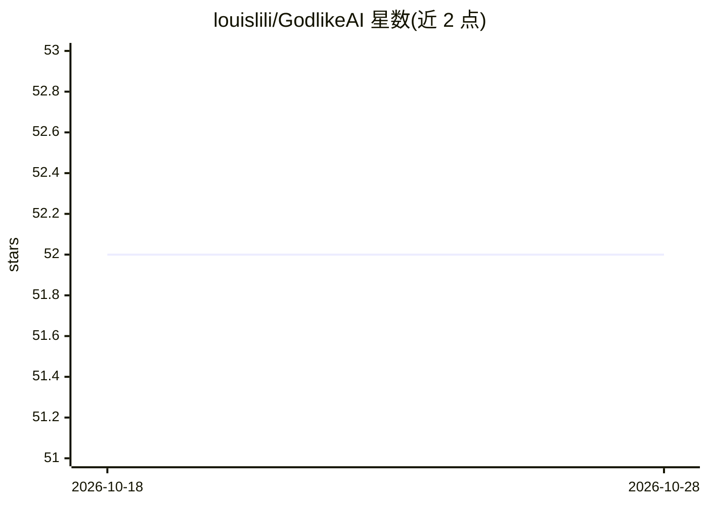

# louislili/GodlikeAI

⭐ 52 · NOASSERTION · 推送 2025-11-13 · [GitHub](https://github.com/louislili/GodlikeAI) · 组织维护 · 中文 README

**面向 FastGPT/Dify 等平台的智能体工作流模板与方法论仓库**

以“神思 Agent”方法论为主题的仓库：沉淀意图路由、多视角推理、记忆与工具调用等设计方法说明，核心可交付物是 workflows/ 目录下按平台分组的智能体工作流定义文件（JSON/YAML），当前包含 6 个 FastGPT 与 Dify 工作流（多意图路由问答、口碑拆句与打标、数据分析助手、Agent Kimi 等），并附同名介绍文档与 collections/ 下的 Agent Schema 约定。面向在智能体平台上导入工作流的用户，许可为 Apache-2.0 附加条款，另有商用授权文档。

## 筛选速览

| 维度 | 判定 | 备注 |
|---|---|---|
| AI 角色 | `ai-knowledge` | 知识聚合/清单类 |
| 许可风险 | `none` | NOASSERTION |
| 部署形态 | `None` |  |
| 模型依赖 | — | README 未给出锁定关系 |
| 硬件要求 | — | 无带数字的原话,不猜 |
| 安装摩擦 | `low` | 无编译、无系统依赖或容器化 |
| 成熟度 | `idea` | |

## 能力要点

- workflows/ 目录按平台存放可导入的 JSON/YAML 工作流定义
- collections/agents.schema.json 约定 Agent 的角色、能力、工具与记忆结构
- “神思 Agent”方法论文档：意图路由、计划—执行—反思闭环、记忆与评估回溯
- 已有 FastGPT（4 个）与 Dify（1 个）工作流条目及同名说明文档

## 适用场景

- 我在 FastGPT/Dify 上搭建智能体时，导入现成工作流少走弯路
- 需要多意图路由问答或口碑情感打标类工作流时查找模板
- 参考 Agent Schema 与命名约定来组织自己的智能体资产

## 场景标签

`工作流自动化` · 领域:效率与自动化

## 证据(README 行号)

> L42: - `workflows/` — 工作流定义（平台或领域分目录存放）
> L50: - 若你的平台支持导入 JSON/YAML，直接使用 `*.workflow.json` 文件进行导入与配置。

## 星数曲线

2026-10-18 52 → 2026-10-28 52（+0）

---
*卡片 v1 · prompt 1.4 · 生成 2026-10-24 · 置信度 mid · 依据 README sha `af8327d0e793` · [字段定义](../../DATASET.md)*
