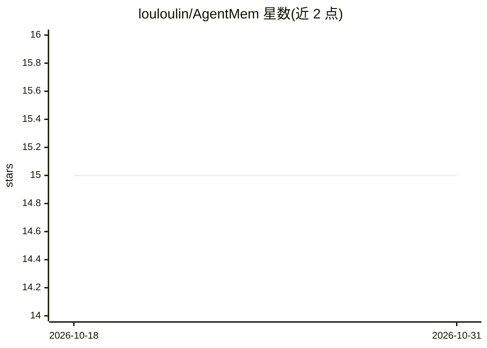

# louloulin/AgentMem

⭐ 15 · Rust · MIT · 推送 2026-06-03 · [GitHub](https://github.com/louloulin/AgentMem) · [官网](https://www.agentmem.cc) · 个人维护 · 中文 README

**给 AI agent 与 LLM 应用的 Rust 持久记忆管理平台**

用 Rust 编写的 AI 记忆管理平台，面向构建 AI agent 与 LLM 应用的开发者：提供跨会话持久记忆、基于 LLM 的自动事实抽取、5 种搜索引擎（向量/BM25/全文/模糊/混合 RRF）、记忆重要性评分与冲突消解、图关系推理。架构上含 WASM 插件系统（沙箱隔离、热重载）、18 个 crate、多后端存储（LibSQL/PostgreSQL/Pinecone/LanceDB/Qdrant）、20+ LLM 提供商接入，以及 MCP 服务器实现（可接入 Claude Code 等客户端）。企业特性包括 RBAC、JWT 认证、审计日志与多租户。提供 Python/JS/Go/Cangjie 绑定与 Docker 部署方式，自称可作 Mem0 的直接替代。

## 筛选速览

| 维度 | 判定 | 备注 |
|---|---|---|
| AI 角色 | `ai-ecosystem` | LLM/agent 周边工具 |
| 许可风险 | `permissive` | MIT |
| 部署形态 | `self-host` | docker 或自建部署 |
| 模型依赖 | locked-api |  |
| 硬件要求 | — | 无带数字的原话,不猜 |
| 安装摩擦 | `low` | 无编译、无系统依赖或容器化 |
| 成熟度 | — | 结构信号不足 |

## 能力要点

- 跨会话持久记忆与 LLM 驱动的事实抽取
- 5 种搜索引擎（向量/BM25/全文/模糊/RRF 混合）
- WASM 插件系统：沙箱隔离、热重载、能力权限
- MCP 服务器实现，5 个核心工具，支持 stdio/HTTP/SSE 传输

## 适用场景

- 为对话式 AI 聊天机器人提供持久用户记忆
- 多 agent 系统通过共享记忆协调
- 构建带语义检索的企业知识库
- 通过 MCP 让 Claude Code 等客户端读写记忆

## 场景标签

`Agent 记忆` · 领域:Agent 开发

## 证据(README 行号)

> L16: **AgentMem** is a high-performance, enterprise-grade memory management platform built in Rust, designed specificall
> L55: - **Automatic fact extraction** powered by LLMs
> L178: AgentMem provides a complete **Model Context Protocol (MCP)** server implementation, enabling seamless integration

## 星数曲线

2026-10-18 15 → 2026-10-31 15（+0）

---
*卡片 v1 · prompt 1.4 · 生成 2026-10-30 · 置信度 high · 依据 README sha `662a7f8b162a` · [字段定义](../../DATASET.md)*
