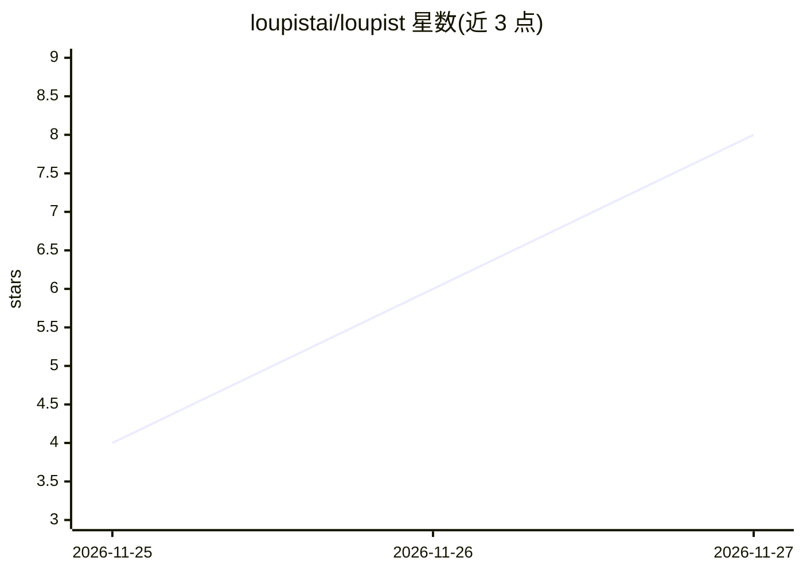

# loupistai/loupist

⭐ 8 · Rust · AGPL-3.0 · 推送 2026-11-25 · [GitHub](https://github.com/loupistai/loupist) · [官网](https://loupist.com) · 组织维护 · 中文 README

**面向投资者的本地优先 AI 投资研究桌面应用**

运行于 Apple Silicon Mac 的开源投资研究应用：读取财报文件与市场数据回答研究问题，回答中每个数字链接到出处原文或计算过程并逐项核对，不匹配时标出差异。研究后自动保留 Sources（原文段落）、World（实体关系知识图谱）、Lens（笔记与方法）三类记忆供后续问题使用；支持定时简报、后台研究任务、用户自定义 principle 覆盖其学到的规则。数据以文件夹形式保存在本机，无账号与服务器；AI 通过用户自有账号或 API key 接入。仅支持 macOS 13+。

## 筛选速览

| 维度 | 判定 | 备注 |
|---|---|---|
| AI 角色 | `ai-native` | 本体是模型或模型工具 |
| 许可风险 | `viral` | AGPL-3.0 |
| 部署形态 | `desktop` | 安装包/桌面程序 |
| 模型依赖 | — | README 未给出锁定关系 |
| 硬件要求 | — | 无带数字的原话,不猜 |
| 安装摩擦 | `low` | 无编译、无系统依赖或容器化 |
| 成熟度 | `idea` | |

## 能力要点

- 回答中的数字逐项回溯到原文段落或计算公式并核对
- Sources/World/Lens 记忆机制在后续研究中复用并标注方法出处
- 本地优先：无账号、无服务器、数据以文件夹形式存于 Mac
- run_python 在无网络的 WASI 离线沙箱中运行

## 适用场景

- 就财报内容提问并核验回答中引用的数字
- 跟踪自选标的的投资论点与逐日证据
- 定时生成晨间简报并执行后台研究任务

## 场景标签

`金融量化` `文档问答` · 领域:知识与检索

## 证据(README 行号)

> L7: A research companion for investors, on your Mac. It reads filings and market data, checks each figure it cites again
> L66: - **Your AI account.** Continue with ChatGPT or SuperGrok, or add an API key from Anthropic, OpenAI, Google Gemini,

## 星数曲线

2026-11-25 4 → 2026-11-27 8（+4）

---
*卡片 v1 · prompt 1.4 · 生成 2026-11-24 · 置信度 high · 依据 README sha `19c4ce174981` · [字段定义](../../DATASET.md)*
