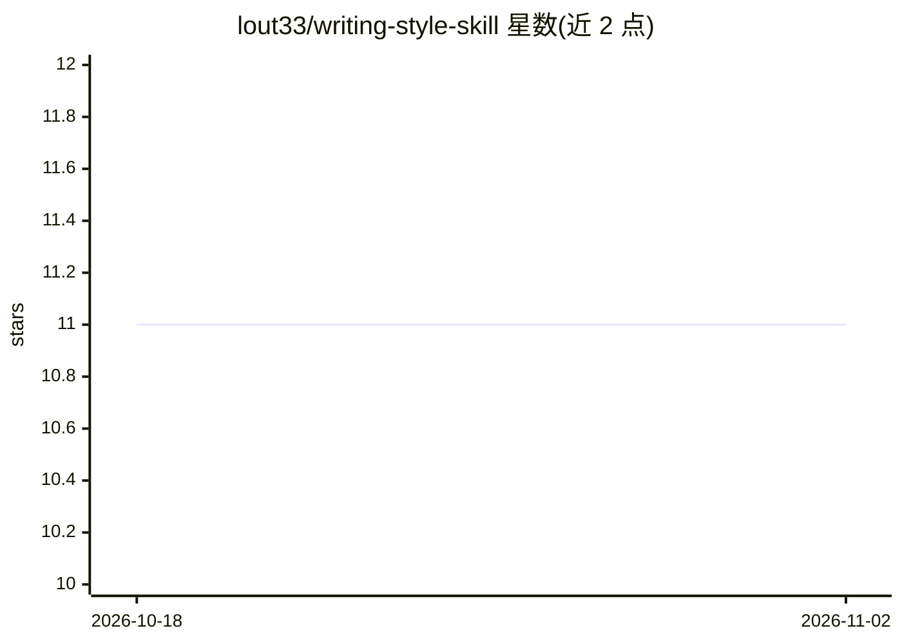

# lout33/writing-style-skill

⭐ 11 · 推送 2026-01-27 · [GitHub](https://github.com/lout33/writing-style-skill) · 个人维护

**把 AI 生成文本改写为个人写作风格的 Claude Code 技能**

面向 Claude Code 与 OpenCode 用户的技能（skill）包：通过 git clone 安装到技能目录并添加 /my-style 命令快捷方式，把任意文本按用户预设的个人风格模板改写，输出仅含改写后文本。风格配置由用户三步生成：从 Gmail/WhatsApp/Slack/Discord/Twitter 导出真实消息，请 AI（Claude/ChatGPT）分析出写作模式，再保存到 references/my-style.md；支持专业与休闲等不同模式分离配置，可迭代补充示例与禁用词。

## 筛选速览

| 维度 | 判定 | 备注 |
|---|---|---|
| AI 角色 | `ai-native` | 本体是模型或模型工具 |
| 许可风险 | `none` | — |
| 部署形态 | `None` |  |
| 模型依赖 | — | README 未给出锁定关系 |
| 硬件要求 | — | 无带数字的原话,不猜 |
| 安装摩擦 | `low` | 无编译、无系统依赖或容器化 |
| 成熟度 | — | 结构信号不足 |

## 能力要点

- 提供 /my-style 命令与自然语言两种调用方式
- 风格模板通过导出真实消息 + AI 分析模式生成
- 支持专业/休闲等多模式分离配置
- 适配 Claude Code 与 OpenCode 两个宿主环境

## 适用场景

- 把 AI 代写的邮件改成自己平时的语气再发送
- 让聊天助手的回复带上有个人特色的表达习惯
- 为不同场合（工作邮件/朋友消息）维护不同风格档案

## 场景标签

`AI 写作` · 领域:内容生成

## 证据(README 行号)

> L15: This skill rewrites any text in your personal style. You define your patterns once, then every AI response gets tra
> L40: /my-style "I hope this email finds you well. I wanted to reach out regarding..."
> L81: Paste your exported messages into Claude/ChatGPT with this prompt:

## 星数曲线

2026-10-18 11 → 2026-11-02 11（+0）

---
*卡片 v1 · prompt 1.4 · 生成 2026-11-02 · 置信度 high · 依据 README sha `49353e5c6389` · [字段定义](../../DATASET.md)*
