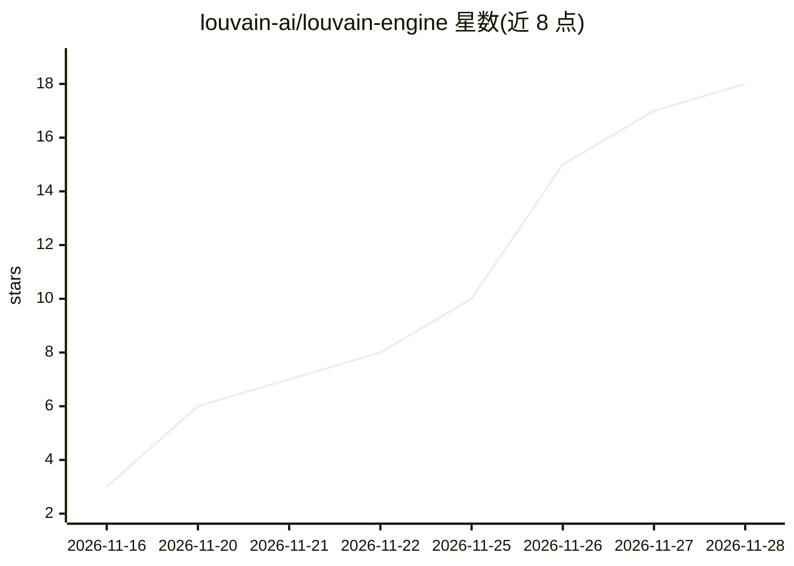

# louvain-ai/louvain-engine

⭐ 18 · TypeScript · Apache-2.0 · 推送 2026-11-24 · [GitHub](https://github.com/louvain-ai/louvain-engine) · [官网](https://louvain.ai/engine) · 组织维护

**为企业 agent/RAG 提供带权限校验的混合检索引擎**

自托管检索引擎：将本地文档经 file readers 切分为 passages，以 pgvector 向量与 BM25 关键词索引在 Postgres 中，检索时先执行权限围栏再融合排序，通过 MCP（三个 louvain_* 工具）与 HTTP 供 agent 调用。插件化架构（readers/sources/retrievers/rerankers/surfaces），用 engine.config.ts 配置，Docker Compose 一键启动；Apache-2.0 许可。README 说明其不含账号体系、不做答案生成、无连接器与 OCR。

## 筛选速览

| 维度 | 判定 | 备注 |
|---|---|---|
| AI 角色 | `ai-ecosystem` | LLM/agent 周边工具 |
| 许可风险 | `permissive` | Apache-2.0 |
| 部署形态 | `self-host` | docker 或自建部署 |
| 模型依赖 | — | README 未给出锁定关系 |
| 硬件要求 | — | 无带数字的原话,不猜 |
| 安装摩擦 | `low` | 无编译、无系统依赖或容器化 |
| 成熟度 | — | 结构信号不足 |

## 能力要点

- 每次查询先过权限围栏，SQL 层面限定可读集合
- 向量+BM25 混合检索，可一行接入 reranker（本地 bge-reranker 或 Cohere API）
- 通过 MCP 提供三个检索工具，可直接注册到 Claude 等客户端
- 插件化架构，./engine plugin new 生成带测试的插件骨架

## 适用场景

- 给企业内部文档建一个带权限控制的检索后端
- 为 MCP 客户端 agent 提供文档搜索工具
- 自托管 RAG 检索层，文档不出本机

## 场景标签

`文档解析` `RAG` `语义搜索` · 领域:知识与检索

## 证据(README 行号)

> L9: The open retrieval engine behind Louvain: it finds the right document in your company’s files, behind a permission
> L109: - **Three ways in.** MCP tools for your agent at `/mcp`, an HTTP door for ingest (off unless configured), and
> L116: Gives an agent the three tools over MCP, with the token the server wrote. The server listens at

## 星数曲线

2026-11-16 3 → 2026-11-28 18（+15）

---
*卡片 v1 · prompt 1.4 · 生成 2026-11-20 · 置信度 high · 依据 README sha `8a3a2a261db1` · [字段定义](../../DATASET.md)*
