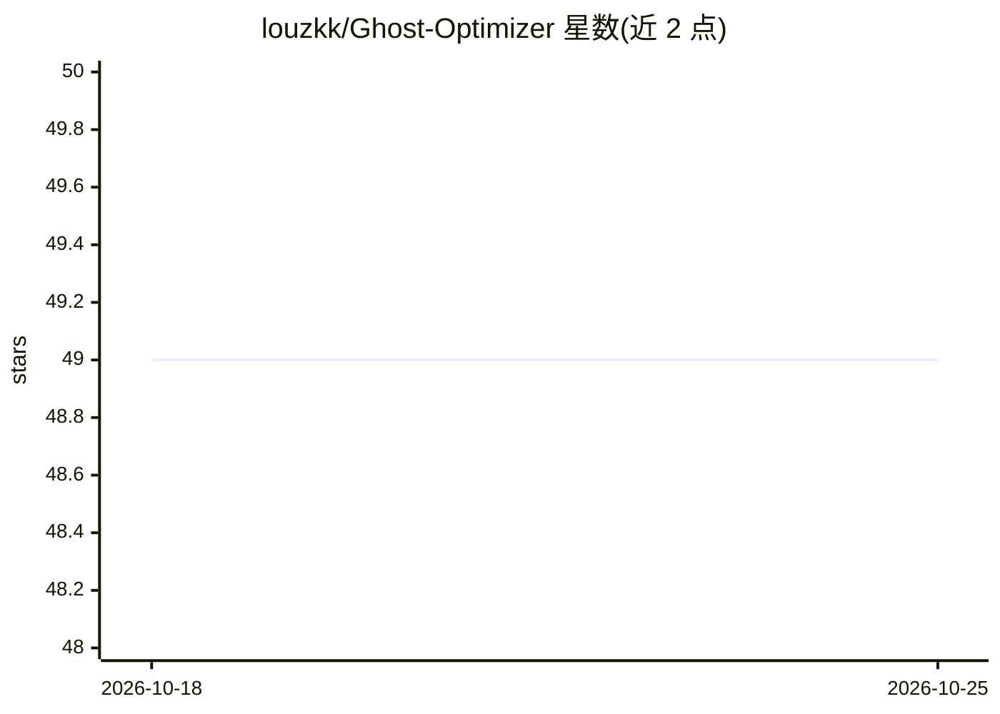

# louzkk/Ghost-Optimizer

⭐ 50 · Batchfile · MIT · 推送 2026-08-24 · [GitHub](https://github.com/louzkk/Ghost-Optimizer) · [官网](https://github.com/louzkk/Ghost-Optimizer) · 个人维护

**Windows 批处理优化脚本：提升性能延迟，移除预装软件与内置 AI 功能**

面向 Windows 用户的开源批处理脚本，通过注册表与策略修改、服务管理、AppX 卸载，以及为 O&O ShutUp10++、NVIDIA Profile Inspector、ViVeTool 下载并应用配置来优化性能、延迟、网络与隐私，并移除 Copilot、Recall 等 AI 功能与预装软件。脚本运行前可创建系统还原点，主菜单提供 R (Revert all) 回滚；Performance 菜单含禁用 VBS/Hyper-V/Spectre 缓解的选项（需确认，可能破坏反作弊并降低防护）。作者声明每项优化均单独测试，使用风险自负。

## 筛选速览

| 维度 | 判定 | 备注 |
|---|---|---|
| AI 角色 | `ai-enhanced` | 去掉 AI 部分产品仍成立 |
| 许可风险 | `permissive` | MIT |
| 部署形态 | `desktop` | 安装包/桌面程序 |
| 模型依赖 | — | README 未给出锁定关系 |
| 硬件要求 | — | 无带数字的原话,不猜 |
| 安装摩擦 | `low` | 无编译、无系统依赖或容器化 |
| 成熟度 | — | 结构信号不足 |

## 能力要点

- 通过注册表/策略/服务/AppX 卸载执行优化
- 移除 Copilot、Recall、Paint/Notepad AI 等内置 AI 功能
- 运行前可创建系统还原点并支持一键回滚
- 为 O&O ShutUp10++、NVIDIA Profile Inspector、ViVeTool 应用自定义配置

## 适用场景

- 清理 Windows 预装软件与内置 AI 功能
- 调整系统设置以优化游戏性能与延迟
- 批量应用隐私加固配置并可回滚

## 场景标签

 · 领域:系统工具/Windows 调优

## 证据(README 行号)

> L11: **Ghost Optimizer** is an open source batch script that focuses on **performance**, **latency**, **network** and **

## 星数曲线

2026-10-18 49 → 2026-10-25 49（+0）

---
*卡片 v1 · prompt 1.4 · 生成 2026-10-24 · 置信度 low · 依据 README sha `375272cc9aea` · [字段定义](../../DATASET.md)*
