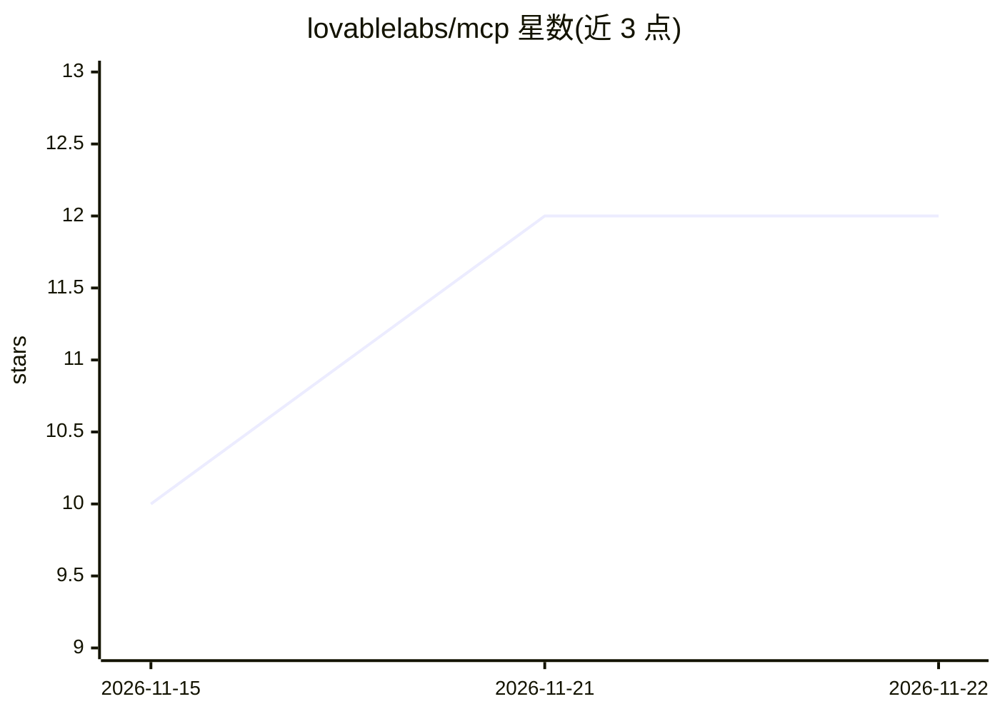

# lovablelabs/mcp

⭐ 12 · Python · Apache-2.0 · 推送 2026-11-16 · [GitHub](https://github.com/lovablelabs/mcp) · 组织维护

**把 Claude 接入 Lovable 的插件：对话中构建并运维应用**

面向 Claude 用户的插件，捆绑官方 Lovable MCP 服务器、13 个技能与 3 个命令：在对话中把想法、表格或设计交付给 Lovable 生成可运行的应用（含数据库与 URL），并对已有 Lovable 项目执行数据查询、安全检查、修复、文档生成等操作。技能在花费积分与发布前需用户确认；插件本身不运行本地代码，仅通过远程 MCP 服务器通信，支持 OAuth 2.1 认证，企业工作区需先启用第三方 MCP 客户端。

## 筛选速览

| 维度 | 判定 | 备注 |
|---|---|---|
| AI 角色 | `ai-ecosystem` | LLM/agent 周边工具 |
| 许可风险 | `permissive` | Apache-2.0 |
| 部署形态 | `None` |  |
| 模型依赖 | locked-api |  |
| 硬件要求 | — | 无带数字的原话,不猜 |
| 安装摩擦 | `low` | 无编译、无系统依赖或容器化 |
| 成熟度 | — | 结构信号不足 |

## 能力要点

- 13 个技能覆盖建应用、CRM、数据问答、安全检查、修复发布等环节
- 花费积分、写库、发布前均需逐步确认，并在发布前停止
- 通过 https://mcp.lovable.dev 远程 MCP 服务器工作，本地不运行代码
- OAuth 2.1（RFC 9728 元数据发现）认证，支持多客户端配置示例

## 适用场景

- 在 Claude 对话中把想法或表格变成带数据库的在线应用
- 用自然语言查询已有 Lovable 应用的数据库数据
- 排查存储费用异常等线上问题并走审批式修复发布

## 场景标签

`代码生成` `数据分析` · 领域:效率与自动化

## 证据(README 行号)

> L3: Build, run and grow real apps from Claude. This plugin bundles the official Lovable MCP server with 13 skills and th
> L117: The plugin connects to one server, the Lovable MCP server at `https://mcp.lovable.dev`, and talks to nothing else.
> L135: **OAuth 2.1.** MCP clients discover the authorization server via RFC 9728 metadata at `https://mcp.lovable.dev/.we

## 星数曲线

2026-11-15 10 → 2026-11-22 12（+2）

---
*卡片 v1 · prompt 1.4 · 生成 2026-11-19 · 置信度 high · 依据 README sha `2faffd80f6ca` · [字段定义](../../DATASET.md)*
