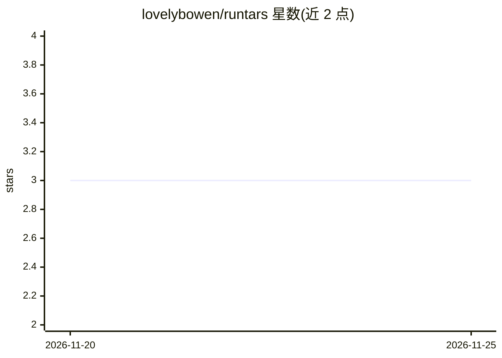

# lovelybowen/runtars

⭐ 3 · TypeScript · Apache-2.0 · 推送 2026-11-23 · [GitHub](https://github.com/lovelybowen/runtars) · [官网](https://runtars.com) · 个人维护

**自托管的 AI 队友平台：持久记忆、例程与沙盒电脑**

开源、可自托管的 AI 队友系统，每个 bot 具备持久记忆、例程（定时/邮件/webhook 触发）、浏览器与终端操作、群聊协作与子代理委派，并能生成可分享的仪表盘与文档页面。通过 Docker Compose 镜像安装，支持 Web、Electron 桌面与 iOS/Android 客户端连接同一服务器；沙盒可运行在本地 Docker、云端或远程 provider。模型由用户自带 API key 接入，集成数千应用与 MCP 服务器。

## 筛选速览

| 维度 | 判定 | 备注 |
|---|---|---|
| AI 角色 | `ai-native` | 本体是模型或模型工具 |
| 许可风险 | `permissive` | Apache-2.0 |
| 部署形态 | `desktop` | 安装包/桌面程序 |
| 模型依赖 | — | README 未给出锁定关系 |
| 硬件要求 | — | 无带数字的原话,不猜 |
| 安装摩擦 | `low` | 无编译、无系统依赖或容器化 |
| 成熟度 | — | 结构信号不足 |

## 能力要点

- 每个 bot 配备浏览器、终端与完整桌面的沙盒电脑，可观察与接管
- 例程调度（定时/邮件/webhook）与群聊 @mention 多 bot 协作
- 支持本地 Docker、e2b/daytona/createos/railway 等多种沙盒 provider
- 自带模型 key 接入任意模型，集成 MCP 与 OpenAPI 工具

## 适用场景

- 在自己的服务器上运行常驻 AI 队友处理日常例程
- 让多个 bot 在群聊中分工协作并互相校验
- 通过 Gmail/Slack/GitHub/Notion 等集成自动化工作流
- 让 bot 生成可分享链接的仪表盘与文档

## 场景标签

`工作流自动化` `多智能体` · 领域:Agent 开发

## 证据(README 行号)

> L12: RunTars is an open source, self-hosted alternative to Grok Bot.
> L14: Persistent AI teammates with their own memory, routines, apps, and computer. Run it on your own
> L36: - Any model, with your own keys

## 星数曲线

2026-11-20 3 → 2026-11-25 3（+0）

---
*卡片 v1 · prompt 1.4 · 生成 2026-11-22 · 置信度 mid · 依据 README sha `bea7a71110ff` · [字段定义](../../DATASET.md)*
