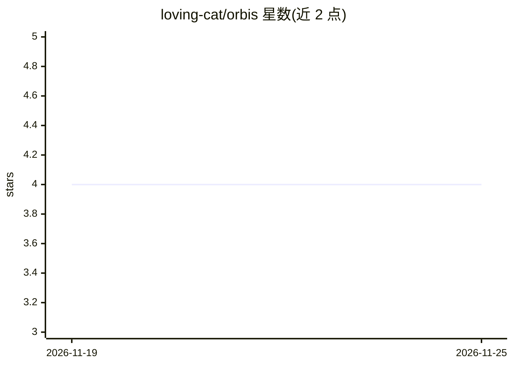

# loving-cat/orbis

⭐ 4 · JavaScript · MIT · 推送 2026-11-23 · [GitHub](https://github.com/loving-cat/orbis) · 个人维护 · 中文 README

**手机与电脑互连的本地多 Agent 协作工位**

由 Flutter 客户端与 Node 服务端组成的本地优先多智能体应用：底层基于 @earendil-works/pi-coding-agent 引擎，用户发一句话后由主控 bot 拆活、部门老大接单、成员并发执行，产出文件作为附件回传。组织上分总经理/部门/成员三级，@名字 即调度信号，带心跳看门狗、发言预算、中途插话与空回复恢复等机制。模型与密钥全部由用户自行配置（任何 OpenAI 兼容接口），无云端中转，手机与电脑需在同一局域网。

## 筛选速览

| 维度 | 判定 | 备注 |
|---|---|---|
| AI 角色 | `ai-native` | 本体是模型或模型工具 |
| 许可风险 | `permissive` | MIT |
| 部署形态 | `desktop` | 安装包/桌面程序 |
| 模型依赖 | — | README 未给出锁定关系 |
| 硬件要求 | — | 无带数字的原话,不猜 |
| 安装摩擦 | `low` | 无编译、无系统依赖或容器化 |
| 成熟度 | — | 结构信号不足 |

## 能力要点

- 总经理/部门老大/成员三级组织，@名字 调度、全员并发、可被打断汇报
- 底层 pi-coding-agent 引擎可读写文件、跑命令、调 MCP，产出落盘回传
- 本地优先：服务端跑在自己机器上，无云端中转，模型 baseUrl/API key 用户自填
- 支持拖拽附件、解析 PDF/Excel/Word 等格式，提供 SDK 与 HTTP/WS 嵌入接口

## 适用场景

- 在手机上指挥电脑端多个 Agent 协作完成编码/文件任务
- 按部门组织多个 bot 分工并监督任务进度
- 通过 SDK 把多智能体运行时嵌入自己的程序

## 场景标签

`多智能体` `编码 Agent` · 领域:Agent 开发

## 证据(README 行号)

> L3: 手机和电脑上的 **Orbis（多智能体团队与全能主控基座）**。你发一句话，主控拆活、部门老大接单、成员各自干活，结果回到你手上。
> L5: 不是套壳聊天——底层基于 `@earendil-works/pi-coding-agent` 引擎：能读写文件、跑命令、开子进程、调 MCP，产出直接落盘并作为附件发回来。
> L64: - **模型菜单完全来自你自己配的模型组**（任何 OpenAI 兼容接口：baseUrl + key + 模型名）

## 星数曲线

2026-11-19 4 → 2026-11-25 4（+0）

---
*卡片 v1 · prompt 1.4 · 生成 2026-11-21 · 置信度 high · 依据 README sha `ae95bda16f2c` · [字段定义](../../DATASET.md)*
