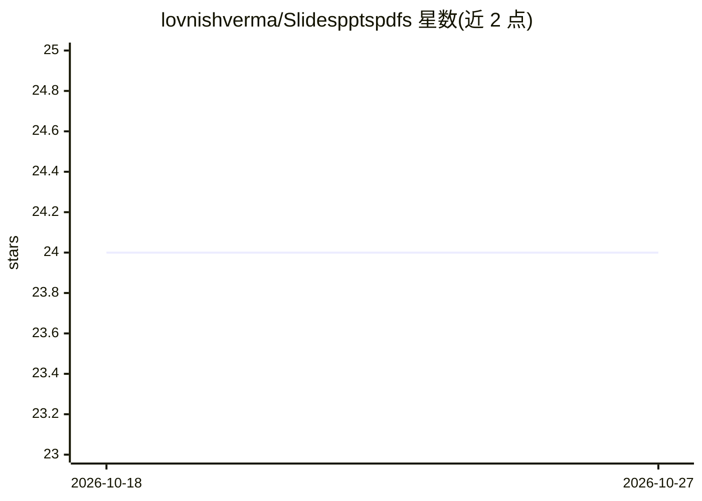

# lovnishverma/Slidespptspdfs

⭐ 24 · Unlicense · 推送 2026-10-23 · [GitHub](https://github.com/lovnishverma/Slidespptspdfs) · [官网](https://github.com/lovnishverma/Slidespptspdfs) · 个人维护

**计算机与数据科学教学用幻灯片/PDF 资源合集**

由 Lovnish Verma 维护的分类教学内容库，收录 Python、数据科学、大数据（Hadoop/Spark）、DBMS、机器学习、Web 爬虫、Web 技术、Jetson Nano 等类别的 PDF 与 PPT，用于工作坊、授课与学生自学。README 另链接一个配套 Colab 实践仓库。内容以文件夹组织，MIT 许可下可教育性使用并要求署名，接受 fork 与 PR 贡献。仓库本体为静态文档集合，不提供可运行的软件或安装流程。

## 筛选速览

| 维度 | 判定 | 备注 |
|---|---|---|
| AI 角色 | `ai-knowledge` | 知识聚合/清单类 |
| 许可风险 | `permissive` | Unlicense |
| 部署形态 | `None` |  |
| 模型依赖 | — | README 未给出锁定关系 |
| 硬件要求 | — | 无带数字的原话,不猜 |
| 安装摩擦 | `low` | 无编译、无系统依赖或容器化 |
| 成熟度 | — | 结构信号不足 |

## 能力要点

- 按 8 个类别组织的教学幻灯片与 PDF
- 覆盖 Python/ML/大数据/DBMS/Web 技术/Jetson Nano
- 面向教师授课、学生复习与自学者三类人群

## 适用场景

- 备课或开展培训工作坊时直接取用现成幻灯片
- 按课程主题复习 Python、ML、DBMS 等内容
- 了解 Jetson Nano 边缘 AI 硬件的上手材料

## 场景标签

`教程课程` · 领域:学习与行业

## 证据(README 行号)

> L7: Welcome to the **Slidespptspdfs** repository by **Lovnish Verma**. This collection contains categorized PDFs, PowerP
> L9: > 🎯 **Purpose**: Provide well-organized teaching material (slides, notes, PDFs) for students, trainers, and self-lea

## 星数曲线

2026-10-18 24 → 2026-10-27 24（+0）

---
*卡片 v1 · prompt 1.4 · 生成 2026-10-27 · 置信度 high · 依据 README sha `5fa8383f12c2` · [字段定义](../../DATASET.md)*
