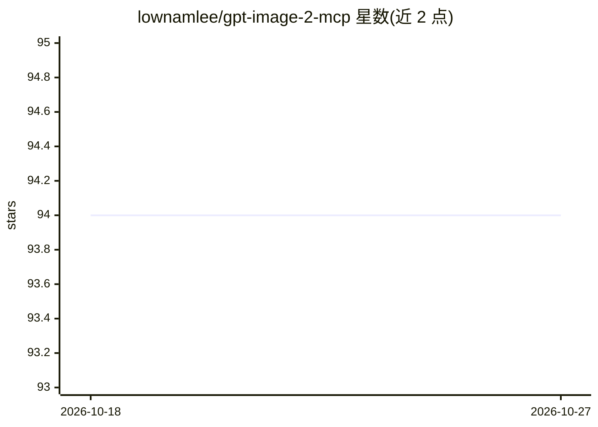

# lownamlee/gpt-image-2-mcp

⭐ 94 · TypeScript · MIT · 推送 2026-07-18 · [GitHub](https://github.com/lownamlee/gpt-image-2-mcp) · 个人维护

**让 MCP 客户端调用 ChatGPT 图像生成的本地 MCP 服务器**

TypeScript 编写的 stdio MCP 服务器，向任意 MCP 兼容客户端暴露 generate_image、backend_status、browser_visibility 三个工具。图像生成有三种后端：api 模式使用 OPENAI_API_KEY 直接调用 gpt-image-2；chatgpt-web 模式通过浏览器登录 chatgpt.com 的账号会话生成，无需 API key；auto 模式先尝试 API 再回退。每次生成写入编号图片文件与 metadata.json 到系统数据目录，返回 output_dir、image_path 等结构化结果。要求 Node.js 20 及以上，通过 MCP 客户端配置接入。

## 筛选速览

| 维度 | 判定 | 备注 |
|---|---|---|
| AI 角色 | `ai-ecosystem` | LLM/agent 周边工具 |
| 许可风险 | `permissive` | MIT |
| 部署形态 | `library` | 以包/库形式分发 |
| 模型依赖 | — | README 未给出锁定关系 |
| 硬件要求 | — | 无带数字的原话,不猜 |
| 安装摩擦 | `low` | 无编译、无系统依赖或容器化 |
| 成熟度 | — | 结构信号不足 |

## 能力要点

- chatgpt-web 模式无需 API key，仅凭 ChatGPT 账号登录生成图像
- api / chatgpt-web / auto 三种后端模式，auto 支持 API 不可用时回退
- 每次生成落盘编号图片文件与 metadata.json，返回结构化元数据
- 仅暴露 3 个 MCP 工具，后端实现隔离在 backend 层

## 适用场景

- 在 Claude 等 MCP 客户端中直接生成并保存图像文件
- 没有 OpenAI API key 时通过 ChatGPT 网页会话生成图像
- 在本地工作流中以 API 优先、网页会话兜底的方式批量生成图像

## 场景标签

`图像生成` · 领域:内容生成

## 证据(README 行号)

> L22: - ⚙️ **MCP server runs:** `gpt-image-2-mcp` handles the image request.
> L75:     A["MCP client"] --> B["gpt-image-2-mcp stdio server"]

## 星数曲线

2026-10-18 94 → 2026-10-27 94（+0）

---
*卡片 v1 · prompt 1.4 · 生成 2026-10-23 · 置信度 high · 依据 README sha `e31fa9a33841` · [字段定义](../../DATASET.md)*
