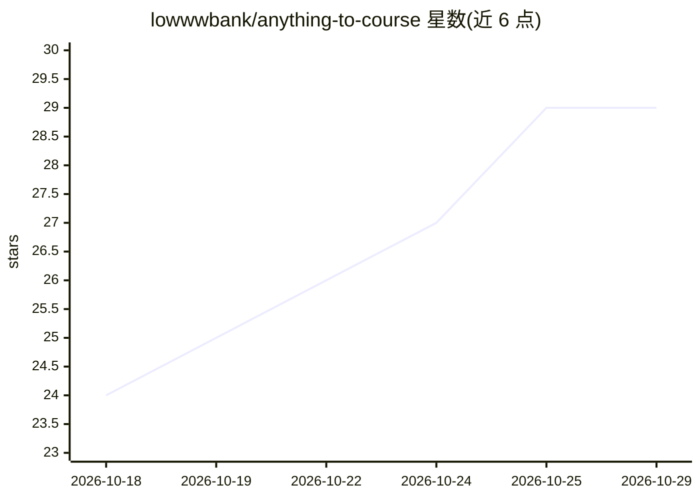

# lowwwbank/anything-to-course

⭐ 29 · MIT · 推送 2026-07-07 · [GitHub](https://github.com/lowwwbank/anything-to-course) · 个人维护

**把任意材料变成学习科学式自学课程的 AI agent 技能**

面向 Claude Code、Codex CLI、Gemini CLI、Cursor 等可读取 SKILL.md 的 AI agent 的通用技能：将文档、笔记、书籍、转录稿、代码库或仅一个主题，转化为包含能力目标、课程、隐藏答案、检查点与间隔复习计划的自学课程包，并可切换为导师模式运行学习会话（检索式提问、置信度校准、间隔复习）。核心机制包括 11 步课程流程、先尝试后看答案、+1/+7/+21-30 天复习计划与 40 项质量核查清单。技能本体为纯 markdown，无脚本、无依赖、无需网络或 API key；材料不足处标记而非编造。

## 筛选速览

| 维度 | 判定 | 备注 |
|---|---|---|
| AI 角色 | `ai-ecosystem` | LLM/agent 周边工具 |
| 许可风险 | `permissive` | MIT |
| 部署形态 | `None` |  |
| 模型依赖 | locked-api |  |
| 硬件要求 | — | 无带数字的原话,不猜 |
| 安装摩擦 | `low` | 无编译、无系统依赖或容器化 |
| 成熟度 | — | 结构信号不足 |

## 能力要点

- 将任意材料转化为按能力目标组织的自学课程包（大纲、模块、隐藏答案、复习计划）
- 11 步标准课时流程：先尝试后讲解、检索练习、错误归因反馈与重试
- 导师模式：检索式提问、置信度校准、间隔复习与学习日志
- 纯 markdown 技能，无脚本无依赖，无需网络访问与 API key

## 适用场景

- 把团队文档或技术手册转成有练习和检查点的自学课程
- 让 agent 以导师身份运行我的复习会话，按间隔计划提问
- 为零基础学习者把一本书或一个主题编排成数周学习计划

## 场景标签

`教程课程` · 领域:学习与行业

## 证据(README 行号)

> L9: A universal AI agent skill that turns documents, notes, books, transcripts, slides, codebases — or just a topic — in
> L13: `anything-to-course` is a portable course-design workflow for AI agents. It does not just summarize source material
> L183: ├── SKILL.md                        # the skill: workflow the agent follows

## 星数曲线

2026-10-18 24 → 2026-10-29 29（+5）

---
*卡片 v1 · prompt 1.4 · 生成 2026-10-26 · 置信度 high · 依据 README sha `1e16f2f5f928` · [字段定义](../../DATASET.md)*
