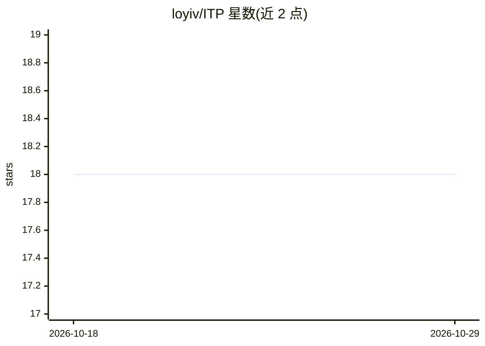

# loyiv/ITP

⭐ 18 · Python · MIT · 推送 2026-09-29 · [GitHub](https://github.com/loyiv/ITP) · [官网](https://arxiv.org/abs/2601.08955) · 个人维护

**LLM 智能体自适应前瞻决策框架：世界模型想象后再行动**

EMNLP 2026 论文 Imagine-then-Plan (ITP) 的官方代码库。针对 LLM 智能体在长程任务中无法可靠前瞻的问题，用学习到的文本世界模型做自适应 K 步想象 rollout，再结合当前状态与预测未来轨迹选择动作，形式化为 POIMDP。提供两种实现：ITP-I 免训练的推理时三阶段流程（选 K、想象、反思后行动），ITP-R 通过 K-head 预测器加三阶段训练（伪标签、SFT 预热、在线 A2C）学习何时想象多长。含世界模型微调脚本，在 ALFWorld 与 ScienceWorld 上评测。

## 筛选速览

| 维度 | 判定 | 备注 |
|---|---|---|
| AI 角色 | `ai-ecosystem` | LLM/agent 周边工具 |
| 许可风险 | `permissive` | MIT |
| 部署形态 | `library` | 以包/库形式分发 |
| 模型依赖 | — | README 未给出锁定关系 |
| 硬件要求 | — | 无带数字的原话,不猜 |
| 安装摩擦 | `medium` | 含编译或系统依赖之一 |
| 成熟度 | — | 结构信号不足 |

## 能力要点

- 文本世界模型驱动的自适应 K 步想象 rollout
- ITP-I：推理时免训练的 Imagine-then-Plan 三阶段流程
- ITP-R：K-head 预测器 + 伪标签/SFT/在线 A2C 三阶段训练
- 支持 ALFWorld 与 ScienceWorld 评测

## 适用场景

- 在长程决策任务中让 LLM 智能体行动前先想象未来
- 复现论文的世界模型训练与 A2C 强化学习流程
- 研究世界模型辅助的智能体前瞻决策

## 场景标签

`强化学习` `Agent 框架` · 领域:Agent 开发

## 证据(README 行号)

> L9: Currently, LLM agents often make irreversible mistakes in long-horizon tasks because they cannot reliably look ahead
> L20: Modern LLM agents often behave reactively: they decide actions from the current observation and short history, whic
> L39: ITP-R learns *when* and *how long* to imagine by adding a lightweight **K-head predictor** on top of the backbone L

## 星数曲线

2026-10-18 18 → 2026-10-29 18（+0）

---
*卡片 v1 · prompt 1.4 · 生成 2026-10-29 · 置信度 mid · 依据 README sha `d00931a4dd54` · [字段定义](../../DATASET.md)*
