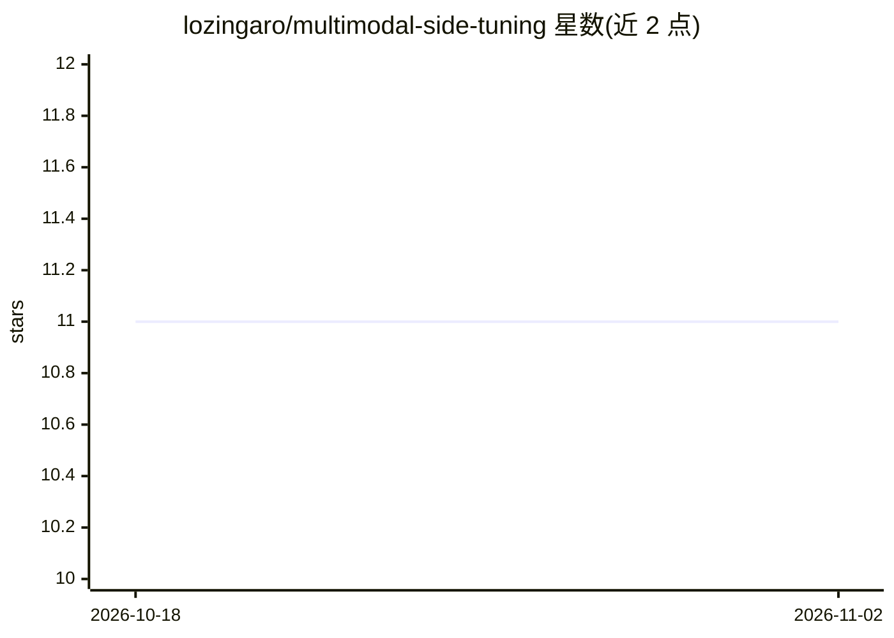

# lozingaro/multimodal-side-tuning

⭐ 11 · Python · GPL-3.0 · 推送 2026-07-13 · [GitHub](https://github.com/lozingaro/multimodal-side-tuning) · [官网](https://lozingaro.github.io/multimodal-side-tuning/) · 个人维护

**多模态 Side-Tuning 文档图像分类的实现与实验代码**

基于 PyTorch 的多模态文档图像分类研究代码：利用 Side-Tuning 网络适配技术，同时从文档图像与文本端到端训练，一侧网络权重锁定、另一侧可更新，通过线性混合参数 alpha 融合视觉与文本特征，最终由全连接层输出 16 类文档分类。使用 MobileNet/ResNet 等轻量预训练架构，在 Tobacco3482 与 RVL-CDIP 数据集上实验。依赖 Python3.6+，经 requirements.txt 安装，FastText 需从源码编译，数据集需自行下载。配套 ICPR2020 论文。

## 筛选速览

| 维度 | 判定 | 备注 |
|---|---|---|
| AI 角色 | `ai-native` | 本体是模型或模型工具 |
| 许可风险 | `viral` | GPL-3.0 |
| 部署形态 | `library` | 以包/库形式分发 |
| 模型依赖 | — | README 未给出锁定关系 |
| 硬件要求 | — | 无带数字的原话,不猜 |
| 安装摩擦 | `low` | 无编译、无系统依赖或容器化 |
| 成熟度 | — | 结构信号不足 |

## 能力要点

- Side-Tuning 网络适配：一侧锁定权重，alpha 控制微调与特征提取
- 图像与文本双通道端到端训练，线性融合多模态特征
- 基于 MobileNet/ResNet 等轻量预训练架构
- 提供 demo_mmst.py 可配置超参数运行实验

## 适用场景

- 复现 ICPR2020 多模态文档分类论文实验
- 在 Tobacco3482/RVL-CDIP 上做文档图像分类研究
- 研究 Side-Tuning 网络适配与多模态特征融合

## 场景标签

`多模态` · 领域:感知与多模态

## 证据(README 行号)

> L13: In this work, we propose to combine different methodologies to automatically and efficiently infer the type of a do
> L14: The framework exploits heterogeneous inputs, since we train end-to-end both from images and text.

## 星数曲线

2026-10-18 11 → 2026-11-02 11（+0）

---
*卡片 v1 · prompt 1.4 · 生成 2026-11-02 · 置信度 high · 依据 README sha `49d3e3c6e705` · [字段定义](../../DATASET.md)*
