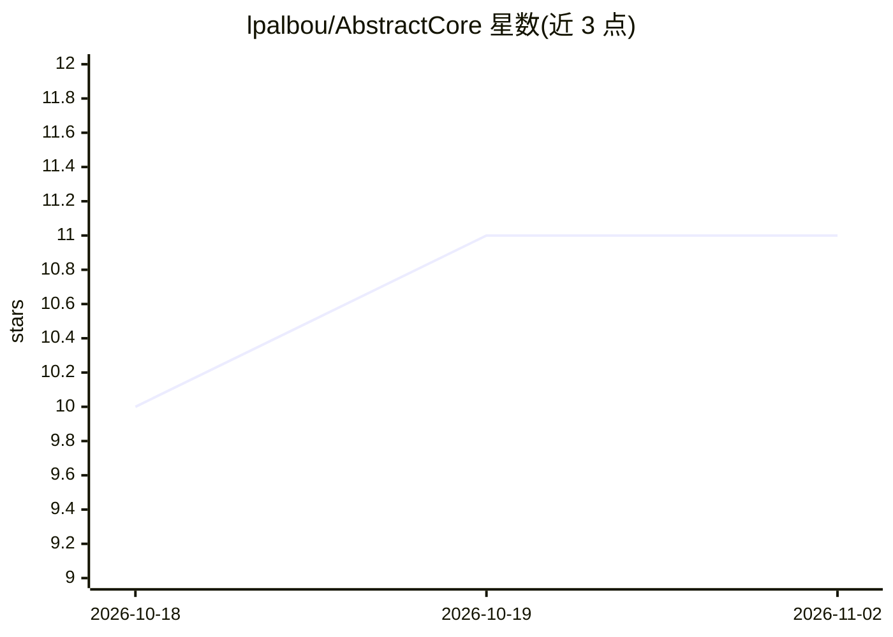

# lpalbou/AbstractCore

⭐ 11 · Python · MIT · 推送 2026-10-29 · [GitHub](https://github.com/lpalbou/AbstractCore) · [官网](https://www.abstractcore.ai) · 个人维护

**Python 的跨提供商 LLM 抽象层：一套 API 接本地与云端模型**

面向 Python 应用的 LLM 基础设施层：提供单一 create_llm(...) API，统一接入本地运行时（Ollama、LM Studio、MLX、HuggingFace/GGUF、vLLM）、云端 API 与 OpenAI 兼容网关，并可自身作为 /v1 网关服务器运行。支持流式、异步、通用工具调用、Pydantic 结构化输出、会话记忆与重试钩子，另有语音/视觉/音乐/3D 可选能力插件。本地运行采取 cache-first、不静默下载权重的策略；默认安装即含全部远程提供商，[apple]/[gpu] 扩展加装本地引擎。属 AbstractFramework 生态，为隐私敏感助手、本地工具与混合部署提供提供商无关的移植层。

## 筛选速览

| 维度 | 判定 | 备注 |
|---|---|---|
| AI 角色 | `ai-ecosystem` | LLM/agent 周边工具 |
| 许可风险 | `permissive` | MIT |
| 部署形态 | `library` | 以包/库形式分发 |
| 模型依赖 | local-ok | 支持本地模型 |
| 硬件要求 | — | 无带数字的原话,不猜 |
| 安装摩擦 | `medium` | 含编译或系统依赖之一 |
| 成熟度 | — | 结构信号不足 |

## 能力要点

- 单一 create_llm API 覆盖本地运行时、云端 API 与 OpenAI 兼容网关
- 可选 OpenAI 兼容 /v1 网关服务器，多提供商并支持 schema 结构化输出
- 通用工具调用（原生+提示式）、Pydantic 结构化输出、会话记忆与重试钩子
- 本地运行 cache-first，不静默下载模型权重，可完全离线

## 适用场景

- 让应用代码在 OpenAI、Anthropic、Ollama、vLLM 等后端间迁移而不改代码
- 为已有 OpenAI API 客户端提供一个统一的本地/混合 /v1 网关
- 构建可完全离线运行的隐私敏感助手或本地开发工具

## 场景标签

`模型网关` · 领域:Agent 开发

## 证据(README 行号)

> L21: AbstractCore is an offline-capable, open-source-first LLM infrastructure layer
> L22: for Python applications. It gives you one `create_llm(...)` API across local
> L23: runtimes, self-hosted servers, cloud APIs, and OpenAI-compatible gateways.

## 星数曲线

2026-10-18 10 → 2026-11-02 11（+1）

---
*卡片 v1 · prompt 1.4 · 生成 2026-11-02 · 置信度 high · 依据 README sha `a17d9e86cb53` · [字段定义](../../DATASET.md)*
