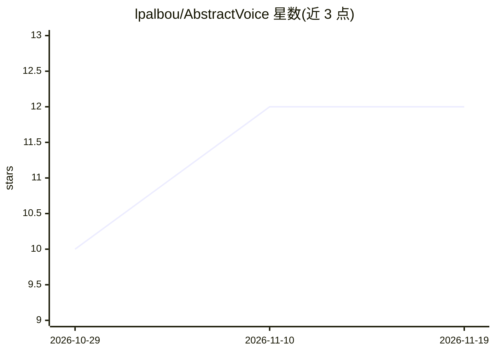

# lpalbou/AbstractVoice

⭐ 12 · Python · MIT · 推送 2026-11-10 · [GitHub](https://github.com/lpalbou/AbstractVoice) · [官网](https://abstractframework.ai/voice) · 个人维护

**为 AI 应用提供统一语音 I/O 的 Python 库：TTS/STT/声音克隆**

面向 AI 应用的模块化语音输入输出库，将 TTS、STT 与可选的声音克隆收拢到 VoiceManager 单一接口之后。默认走 OpenAI 兼容的远程音频端点，另提供平台本地引擎栈：Apple Silicon 上经 MLX 运行 Qwen3-TTS 与 mlx-whisper，GPU 上运行 faster-whisper（NVIDIA CUDA）与 Piper、Supertonic 等。内置 6 种语言 70 个预设音色，支持流式 TTS 与本地克隆。可作为独立库嵌入，也可作为 AbstractCore 能力插件或 AbstractFramework 的语音组件使用；基座安装为远程优先，需 OPENAI_API_KEY，本地栈需按 extras 安装。当前状态为 alpha。

## 筛选速览

| 维度 | 判定 | 备注 |
|---|---|---|
| AI 角色 | `ai-native` | 本体是模型或模型工具 |
| 许可风险 | `permissive` | MIT |
| 部署形态 | `library` | 以包/库形式分发 |
| 模型依赖 | — | README 未给出锁定关系 |
| 硬件要求 | — | 无带数字的原话,不猜 |
| 安装摩擦 | `medium` | 含编译或系统依赖之一 |
| 成熟度 | `idea` | |

## 能力要点

- VoiceManager 单一接口覆盖 TTS、STT 与可选声音克隆
- 本地引擎栈：MLX 上的 Qwen3-TTS（Apple GPU）、Piper、Supertonic、faster-whisper、mlx-whisper
- 流式 TTS：首句先行起播，断流可从最近完整段落的偏移处恢复
- 70 个内置 Qwen3-TTS 音色，覆盖 6 种语言

## 适用场景

- 给本地助手或桌面应用嵌入语音播报与转写能力
- Apple Silicon 上离线运行 TTS 与 STT，不依赖远程 API
- 通过 AbstractCore 让 agent 获得 voice/audio 能力
- 从录音或文字描述创建可复用的克隆音色

## 场景标签

`语音合成` `语音识别` · 领域:内容生成

## 证据(README 行号)

> L9: Lightweight **voice I/O** for AI applications: remote/OpenAI-compatible audio
> L111: **Important**: AbstractVoice is a **voice I/O library** (TTS/STT + optional
> L200: For local Qwen3-TTS, install `abstractvoice[qwen3-tts]` and prefetch the

## 星数曲线

2026-10-29 10 → 2026-11-19 12（+2）

---
*卡片 v1 · prompt 1.4 · 生成 2026-11-18 · 置信度 high · 依据 README sha `750728495c76` · [字段定义](../../DATASET.md)*
