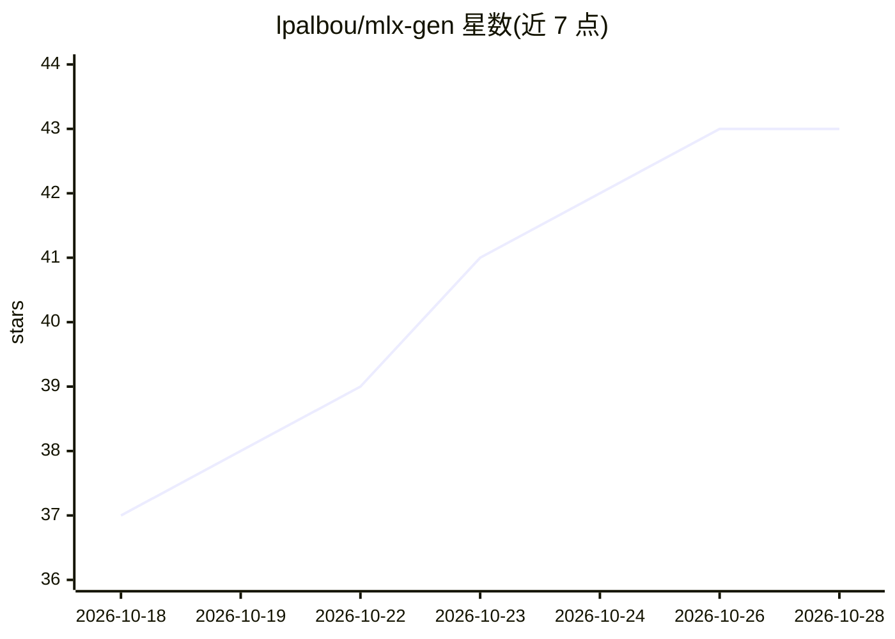

# lpalbou/mlx-gen

⭐ 42 · Python · MIT · 推送 2026-09-21 · [GitHub](https://github.com/lpalbou/mlx-gen) · [官网](http://www.lpalbou.info/mlx-gen/) · 个人维护

**Apple Silicon 本地图像/视频生成运行时（MLX）**

基于 MLX 的本地生成运行时，mflux 的 fork。提供 `mlxgen` 命令与 Python 运行时，支持文生图、图生图、指令/掩码编辑、外扩（outpaint）、Wan2.2 文/图生视频与视频编辑、MiniMax-H3 带同步立体声的视频生成、Bernini-R 参考图视频生成，以及 SeedVR2/SwiftVR 图像视频修复与放大。用户先显式 download/prepare 模型再生成，仅使用本地磁盘文件；面向桌面应用、工作流引擎与长时间本地任务嵌入，提供进度回调与能力 JSON 检查。部分路由有实验性标注与特定限制（如 video-to-video 限 A14B 模型且需 unipc solver）。

## 筛选速览

| 维度 | 判定 | 备注 |
|---|---|---|
| AI 角色 | `ai-native` | 本体是模型或模型工具 |
| 许可风险 | `permissive` | MIT |
| 部署形态 | `library` | 以包/库形式分发 |
| 模型依赖 | — | README 未给出锁定关系 |
| 硬件要求 | — | 无带数字的原话,不猜 |
| 安装摩擦 | `low` | 无编译、无系统依赖或容器化 |
| 成熟度 | `idea` | |

## 能力要点

- text-to-image/image-to-image 涵盖 Qwen Image、FLUX.2 Klein、Z-Image 等模型及其量化变体
- Wan2.2 文/图生视频、掩码视频编辑与 Wan2.1-VACE 参考/掩码条件路由
- MiniMax-H3 生成 5-15 秒带同步立体声 MP4 的视频
- SeedVR2/SwiftVR 图像与视频修复放大，发布量化 HF 包
- 面向应用的进度事件回调与逐步生成预览

## 适用场景

- 在 Mac 上本地运行图像与视频生成，不依赖云端服务
- 桌面应用或工作流引擎嵌入生成能力并跟踪进度
- 先下载模型再做长时间批量本地生成任务

## 场景标签

`图像生成` `视频生成` `图像视频处理` · 领域:内容生成

## 证据(README 行号)

> L7: MLX-Gen is a local image and video generation runtime for Apple Silicon and MLX. It exposes
> L8: `mlxgen` for text-to-image, image-to-image, text-to-video, image-to-video, model download, model
> L9: preparation, SeedVR2 and SwiftVR image/video restoration and upscaling, optimized quantized model

## 星数曲线

2026-10-18 37 → 2026-10-28 43（+6）

---
*卡片 v1 · prompt 1.4 · 生成 2026-10-25 · 置信度 high · 依据 README sha `12373226cf3f` · [字段定义](../../DATASET.md)*
