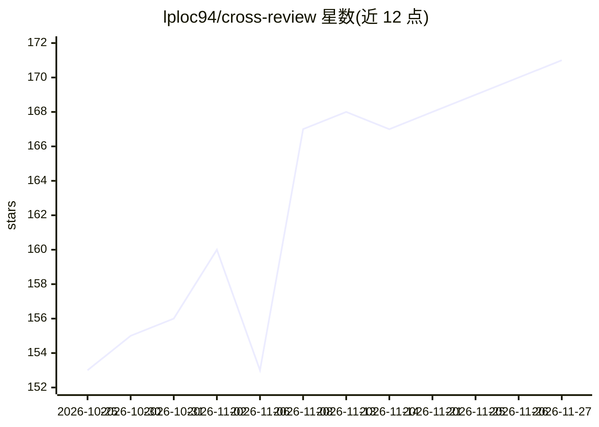

# lploc94/cross-review

⭐ 171 · JavaScript · MIT · 推送 2026-11-11 · [GitHub](https://github.com/lploc94/cross-review) · [官网](https://cross-review.tlelabs.com) · 个人维护

**为 Claude Code/Codex CLI 提供跨模型交叉评审的开发者技能包**

面向使用 AI 编码代理的开发者的跨模型评审工具集：由主力代理负责编排，第二个模型在三层编译版 Principal Reviewer 提示下评审其计划、代码与推理。提供 6 个技能（loop-plan、loop-implement、review-plan、review-impl、review-think、review-pr），默认审阅者为 Codex CLI，也可换 Claude Code 或 Antigravity；经各 CLI 的适配器驱动，通过 MCP 工具或 CLI 回退运行。安装器注册技能与 MCP 服务器，附带本地 Web 仪表盘查看评审会话与计划进度；要求 Node.js ≥22 与至少一个已登录的审阅者 CLI。

## 筛选速览

| 维度 | 判定 | 备注 |
|---|---|---|
| AI 角色 | `ai-ecosystem` | LLM/agent 周边工具 |
| 许可风险 | `permissive` | MIT |
| 部署形态 | `desktop` | 安装包/桌面程序 |
| 模型依赖 | — | README 未给出锁定关系 |
| 硬件要求 | — | 无带数字的原话,不猜 |
| 安装摩擦 | `low` | 无编译、无系统依赖或容器化 |
| 成熟度 | — | 结构信号不足 |

## 能力要点

- 6 个评审/规划技能，覆盖计划、实现、推理与 PR 评审
- 默认 Codex CLI 审阅者，可切换 Claude Code 或 Antigravity，每个审阅者保留独立模型与 effort 配置
- 通过 MCP 服务器（review_begin/wait/reply/end）与 CLI 回退两种方式驱动评审
- 本地 Web 仪表盘展示评审会话、议题台账与计划进度

## 适用场景

- 在大改动实施前让另一家模型辩论并评审实现计划
- 提交/推送/合并前让第二模型审查未提交变更或分支
- 让代理按 TDD 逐步执行已批准的实施方案并带检查点评审
- 以同行视角审查他人 PR 的正确性与可合并性

## 场景标签

`代码审查` · 领域:编码与开发

## 证据(README 行号)

> L11: Cross-model review skills for Claude Code, OpenAI Codex CLI, and Antigravity CLI: the agent you work with orchestra
> L124: - The review skills use the MCP tools `review_begin`, `review_wait`, `review_reply`, `review_end`. Without MCP, or

## 星数曲线

2026-10-25 153 → 2026-11-27 171（+18）

---
*卡片 v1 · prompt 1.4 · 生成 2026-11-26 · 置信度 high · 依据 README sha `b2e70356a71b` · [字段定义](../../DATASET.md)*
