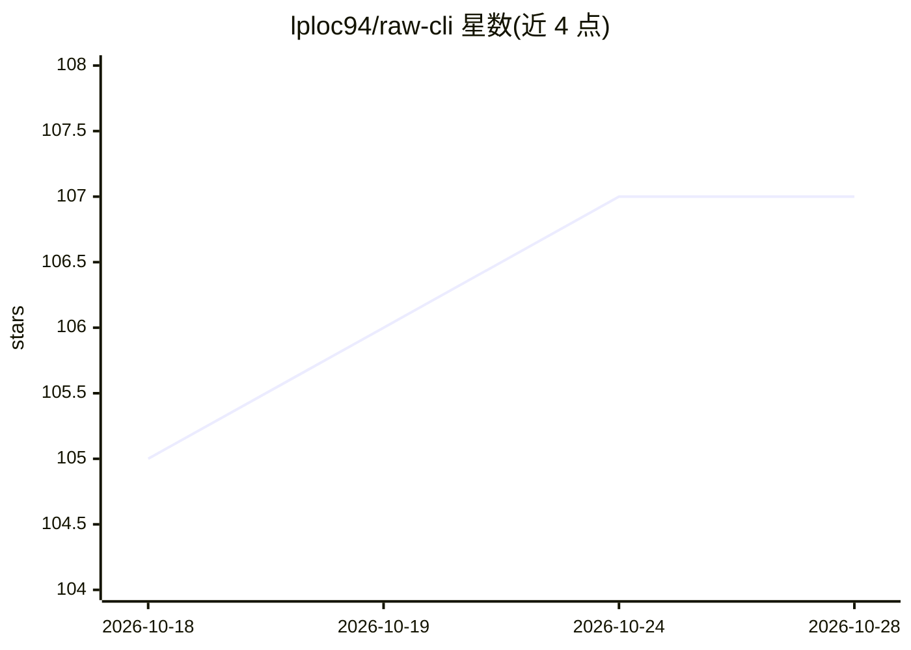

# lploc94/raw-cli

⭐ 107 · TypeScript · MIT · 推送 2026-10-28 · [GitHub](https://github.com/lploc94/raw-cli) · [官网](https://raw.tlelabs.com) · 个人维护

**可 fork 的 agent harness：工具循环、压缩、会话、审批皆文件化**

TypeScript 编写的命令行 agent 框架，提供可运行的 agent 循环、上下文自动压缩、会话保存与恢复、审批策略、终端 REPL、本地浏览器 dashboard 及 Agent Client Protocol（ACP）供 IDE 或父 agent 调用。工具、技能、钩子、策略均为可编辑文件：内置 14 个插件式工具，技能为 Markdown 文件，有序策略规则支持 allow/ask/deny，可接入选定 MCP 工具，并可用 .rawpkg 打包分发 agent。模型通过配置 wire API（OpenAI/Anthropic/Google 格式）连接任意服务。要求 Node.js 22.13+。

## 筛选速览

| 维度 | 判定 | 备注 |
|---|---|---|
| AI 角色 | `ai-ecosystem` | LLM/agent 周边工具 |
| 许可风险 | `permissive` | MIT |
| 部署形态 | `desktop` | 安装包/桌面程序 |
| 模型依赖 | — | README 未给出锁定关系 |
| 硬件要求 | — | 无带数字的原话,不猜 |
| 安装摩擦 | `low` | 无编译、无系统依赖或容器化 |
| 成熟度 | — | 结构信号不足 |

## 能力要点

- 内置 14 个工具均为可 fork 的插件，单个 index.mjs 即可写新工具
- 有序策略规则（allow/ask/deny）与事件钩子（session/prompt/tool）
- 支持 MCP（stdio 与 Streamable HTTP）及 ACP 编辑器接入
- .rawpkg 打包将 agent 连同工具、技能分发给团队安装

## 适用场景

- 在现成循环上改工具和策略，搭建内部或编码 agent
- 团队内以 .rawpkg 分发配好的 agent
- 通过 dashboard 审查工具调用与上下文用量并处理审批

## 场景标签

`Agent 框架` · 领域:Agent 开发

## 证据(README 行号)

> L5: `raw` is the agent harness you can fork. The parts every agent needs already work: the tool loop, context compaction
> L15: Each agent selects ordered tools, skills and hooks, and can supply a system prompt, so a request carries only what 

## 星数曲线

2026-10-18 105 → 2026-10-28 107（+2）

---
*卡片 v1 · prompt 1.4 · 生成 2026-10-23 · 置信度 high · 依据 README sha `d221ff5fa7f1` · [字段定义](../../DATASET.md)*
