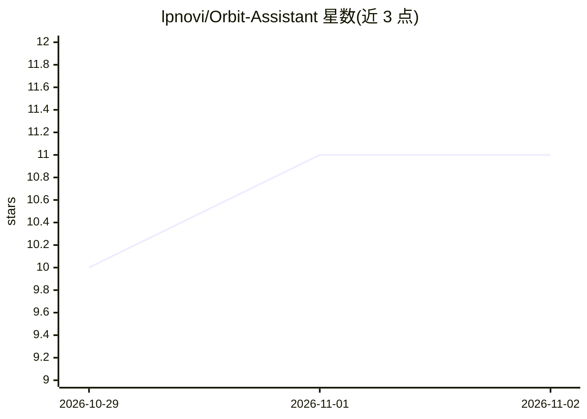

# lpnovi/Orbit-Assistant

⭐ 11 · Java · MPL-2.0 · 推送 2026-11-01 · [GitHub](https://github.com/lpnovi/Orbit-Assistant) · 个人维护

**Android 全局 AI 助手应用：侧键唤起、屏幕上下文与设备操作**

面向 Android 10+ 用户的开源 AI 助手应用：可设为系统数字助手，通过手势或侧键在任意应用上方唤起悬浮层，支持输入、语音（Beta）、附件（图片/PDF/剪贴板）、屏幕文本或截图上下文，并在完整聊天应用中延续对话。设备操作覆盖定时器、闹钟、日历、媒体、手电筒等，经 Android 权限确认执行；提供 Routines 自动化、Orbit Deck 快捷面板与深度主题定制。模型可自选提供商（ChatGPT 账号、Claude/Grok API key、OpenRouter，或可选的 Orbit Local 本地组件）。以 APK 形式从 GitHub Releases 分发，含 SHA-256 校验，主 APK 无 ABI 原生库，Orbit Local 打包 arm64-v8a 库。

## 筛选速览

| 维度 | 判定 | 备注 |
|---|---|---|
| AI 角色 | `ai-native` | 本体是模型或模型工具 |
| 许可风险 | `permissive` | MPL-2.0 |
| 部署形态 | `desktop` | 安装包/桌面程序 |
| 模型依赖 | locked-api |  |
| 硬件要求 | — | 无带数字的原话,不猜 |
| 安装摩擦 | `low` | 无编译、无系统依赖或容器化 |
| 成熟度 | — | 结构信号不足 |

## 能力要点

- 悬浮于任意应用上方调用，支持屏幕上下文（需用户确认附加）
- 设备操作：定时器/闹钟/日历/媒体/手电筒等经 Android 权限执行
- Routines 自动化（步骤/条件/分支/时间位置触发）与声明式 Extensions
- 多提供商接入：ChatGPT 账号、Claude/Grok key、OpenRouter、Orbit Local 本地组件

## 适用场景

- 不离开当前应用，随时唤起 AI 处理屏幕内容或提问
- 让助手代为设置提醒、定时器、日历事件等手机操作
- 把常用步骤沉淀为 Routines 自动化或 Deck 快捷方式
- 用 Orbit Local 在支持的硬件上做离线对话

## 场景标签

`AI 助手` `工作流自动化` · 领域:效率与自动化

## 证据(README 行号)

> L33: Set Orbit as Android's digital assistant and call it from the system assistant gesture or a mapped Side button. It 
> L54: |**Choose how Orbit thinks**|Pick the provider, model and reasoning strength yourself, per chat; Orbit always uses 

## 星数曲线

2026-10-29 10 → 2026-11-02 11（+1）

---
*卡片 v1 · prompt 1.4 · 生成 2026-11-02 · 置信度 high · 依据 README sha `7dfdd68bf7c9` · [字段定义](../../DATASET.md)*
