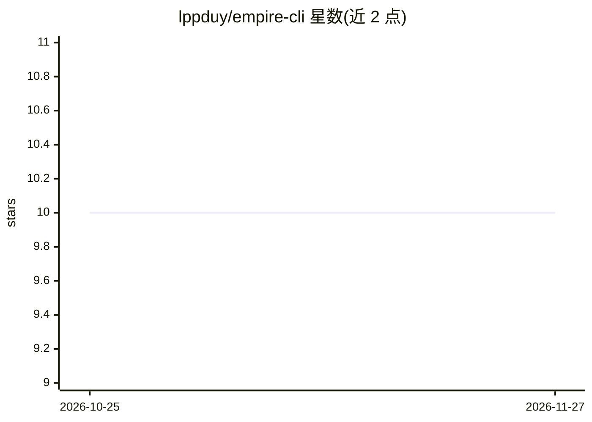

# lppduy/empire-cli

⭐ 10 · TypeScript · 推送 2026-03-18 · [GitHub](https://github.com/lppduy/empire-cli) · 个人维护

**终端回合制策略 RPG：建帝国、扩张并征服世界**

基于 TypeScript + Node.js 18+ 的命令行回合制策略 RPG：玩家选地图与阵营，通过 move/recruit/attack/build 等指令每回合执行 3 个动作，消耗金币/食物/木材/石头四种资源，辅以外交（结盟/和平/贸易）与建筑系统，征服全部领土获胜，支持存档。可选开启 AI Narrator，为战斗、回合总结与胜利生成奇幻叙述；不开启时游戏功能完整。

## 筛选速览

| 维度 | 判定 | 备注 |
|---|---|---|
| AI 角色 | `ai-enhanced` | 去掉 AI 部分产品仍成立 |
| 许可风险 | `permissive` | — |
| 部署形态 | `library` | 以包/库形式分发 |
| 模型依赖 | local-ok | 支持本地模型 |
| 硬件要求 | — | 无带数字的原话,不猜 |
| 安装摩擦 | `low` | 无编译、无系统依赖或容器化 |
| 成熟度 | — | 结构信号不足 |

## 能力要点

- 2 张地图、各 6 个阵营的回合制策略玩法与外交系统
- 可选 AI Narrator：战斗、回合总结与胜利的奇幻叙述（Gemini 或 Ollama llama3）
- npx 即玩，JSON 存档于 ~/.empire-cli/saves/
- walls/barracks/market 三种建筑与四资源经济

## 适用场景

- 在终端里玩一局回合制帝国征服策略游戏
- 开启 AI 叙述为对战过程生成旁白
- 通过存档续玩多局战役

## 场景标签

 · 领域:游戏/终端工具

## 证据(README 行号)

> L8: A CLI turn-based strategy RPG where you build armies, expand your empire, and conquer the world. Open source, runs i
> L106: ## AI Narrator (Optional)
> L108: Enable epic fantasy narration for battles, turn summaries, and victories. The game works perfectly without it.

## 星数曲线

2026-10-25 10 → 2026-11-27 10（+0）

---
*卡片 v1 · prompt 1.4 · 生成 2026-11-19 · 置信度 high · 依据 README sha `357f330a643f` · [字段定义](../../DATASET.md)*
