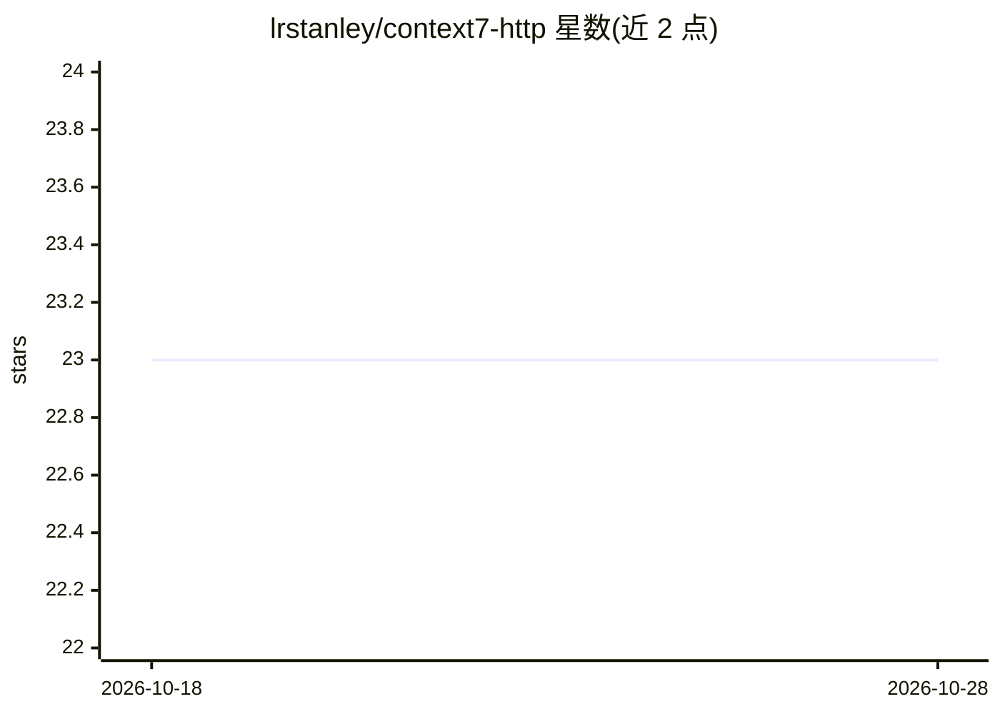

# lrstanley/context7-http

⭐ 23 · Go · MIT · 推送 2026-10-15 · [GitHub](https://github.com/lrstanley/context7-http) · 个人维护

**Context7 的 HTTP/SSE MCP 服务器封装，可远程调用文档检索**

用 Go 编写的 MCP 服务器，将 Context7 项目的库文档检索能力通过 HTTP streamable 与 SSE 端点暴露，使用户无需本地安装 MCP 服务器即可从 VSCode、Cursor 等 MCP 客户端远程调用 resolve-library-uri 和 search-library-docs 两个工具查找库与文档。维护者提供公开托管实例 context7.liam.sh，也支持自行运行二进制（可配置绑定地址、反向代理信任、心跳间隔）或使用 ghcr 容器镜像。限制：依赖 Context7 v1 API，该版本未来可能被移除。

## 筛选速览

| 维度 | 判定 | 备注 |
|---|---|---|
| AI 角色 | `ai-ecosystem` | LLM/agent 周边工具 |
| 许可风险 | `permissive` | MIT |
| 部署形态 | `self-host` | docker 或自建部署 |
| 模型依赖 | — | README 未给出锁定关系 |
| 硬件要求 | — | 无带数字的原话,不猜 |
| 安装摩擦 | `low` | 无编译、无系统依赖或容器化 |
| 成熟度 | — | 结构信号不足 |

## 能力要点

- HTTP streamable 与 SSE 端点支持，无需本地安装
- 提供 resolve-library-uri 与 search-library-docs 两个文档检索工具
- 发布 ghcr 容器镜像，可自托管
- 维护者提供公开托管实例

## 适用场景

- 在 VSCode/Cursor 等 MCP 客户端中远程接入 Context7 文档检索
- 为团队自托管一个集中式的 Context7 MCP 服务
- 在本地安装受限的环境下使用 Context7 能力

## 场景标签

`语义搜索` · 领域:知识与检索

## 证据(README 行号)

> L50: **context7-http** is a MCP server that supports HTTP streaming for the Context7 project.
> L53: - HTTP `streamable` support.

## 星数曲线

2026-10-18 23 → 2026-10-28 23（+0）

---
*卡片 v1 · prompt 1.4 · 生成 2026-10-27 · 置信度 high · 依据 README sha `a32ae7189989` · [字段定义](../../DATASET.md)*
