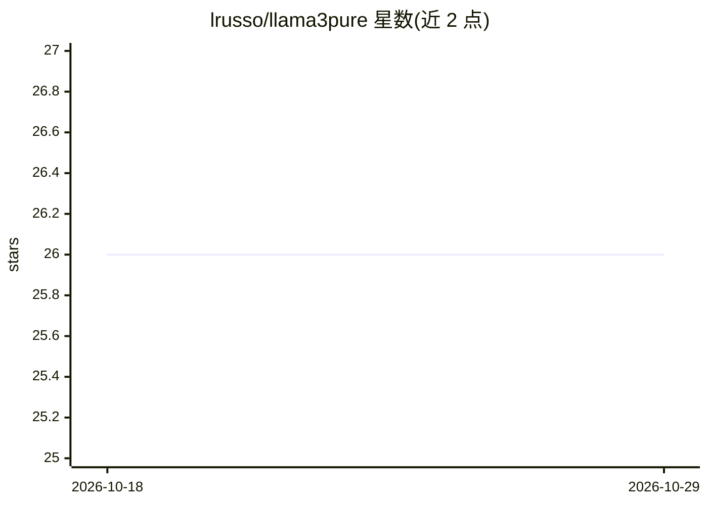

# lrusso/llama3pure

⭐ 26 · HTML · MIT · 推送 2026-10-27 · [GitHub](https://github.com/lrusso/llama3pure) · [官网](https://lrusso.github.io/llama3pure) · 个人维护

**纯 C/JS 实现的 Llama 3 与 Gemma 推理引擎，覆盖桌面/Node/浏览器**

三个无依赖推理引擎：纯 C 引擎在 macOS/Linux/Windows 桌面编译运行，通过 make 或 MSVC cl 编译，命令行加载 GGUF 模型做单轮/多轮对话；纯 JavaScript 引擎分别面向 Node.js 与 Web（Web Worker 传输 ArrayBuffer、流式 token 回调）。支持 Llama 与 Gemma 架构，提供温度、top-p、top-k 等采样参数。README 列出建议与已测试的 GGUF 模型清单；限制包括 Web 端 2 GB 文件上限、低于 Q4 量化不建议使用。基于 karpathy/llama2.c 的工作。

## 筛选速览

| 维度 | 判定 | 备注 |
|---|---|---|
| AI 角色 | `ai-ecosystem` | LLM/agent 周边工具 |
| 许可风险 | `permissive` | MIT |
| 部署形态 | `desktop` | 安装包/桌面程序 |
| 模型依赖 | — | README 未给出锁定关系 |
| 硬件要求 | — | 无带数字的原话,不猜 |
| 安装摩擦 | `low` | 无编译、无系统依赖或容器化 |
| 成熟度 | — | 结构信号不足 |

## 能力要点

- 纯 C 引擎（make/MSVC 编译）与纯 JS 引擎（Node.js/Web Worker）三套实现
- 读取 GGUF 模型文件，支持 Llama 与 Gemma 架构
- 多轮对话历史、系统提示、temperature/top-p/top-k 采样参数
- Web 端提供流式 token 回调与 base64 内嵌 Worker 的独立版

## 适用场景

- 在桌面/Node/浏览器环境本地运行 Llama 3 或 Gemma 小模型推理
- 将纯 JS 推理嵌入网页，无需服务器端推理后端
- 查阅不同量化级别模型在三种引擎上的兼容性测试结果

## 场景标签

`推理引擎` · 领域:训练与推理

## 证据(README 行号)

> L3: Three inference engines for Llama 3: pure C for desktop systems, pure JavaScript for Node.js, and pure JavaScript fo
> L12: make llama3pure
> L20: cl /O2 llama3pure-c-engine.c /Fe:llama3pure.exe

## 星数曲线

2026-10-18 26 → 2026-10-29 26（+0）

---
*卡片 v1 · prompt 1.4 · 生成 2026-10-26 · 置信度 high · 依据 README sha `050a77e87da4` · [字段定义](../../DATASET.md)*
