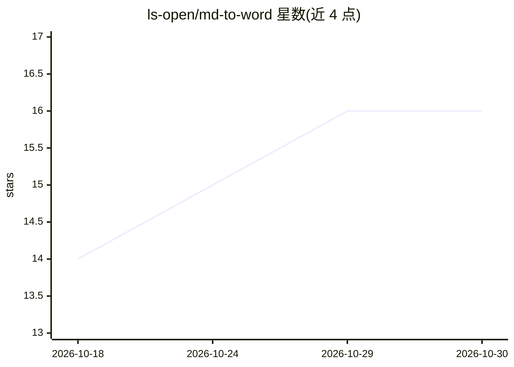

# ls-open/md-to-word

⭐ 16 · Python · MIT · 推送 2026-10-28 · [GitHub](https://github.com/ls-open/md-to-word) · [官网](https://ls-open.github.io/md-to-word/) · 个人维护 · 中文 README

**Markdown 确定性转出版级 Word 的编译器与 MCP 服务**

以 Python 实现的 Markdown→docx 编译引擎，采用声明式排版契约，同一源文件重编译产物逐字节一致；内建 OMML 矢量公式、三线表、页眉页脚与中西文字体分离等出版排版，并在导出前执行带行号的格式预检与自愈指引。面向学术期刊、学位论文、公文写作者，以及通过 MCP 协议（Claude Desktop/Cursor 等）或 Agent Skill（Claude Code/Nature Skills）调用它的 AI Agent。提供 Web 在线体验站、uvx 自动拉取的 MCP 形态、npx 一键挂载技能、本地 pip/CLI/SDK 四种接入方式，本地编译不依赖大模型 API；另支持从既有 docx 模板反推格式规则文件。要求 Python 3.10+。

## 筛选速览

| 维度 | 判定 | 备注 |
|---|---|---|
| AI 角色 | `ai-ecosystem` | LLM/agent 周边工具 |
| 许可风险 | `permissive` | MIT |
| 部署形态 | `library` | 以包/库形式分发 |
| 模型依赖 | — | README 未给出锁定关系 |
| 硬件要求 | — | 无带数字的原话,不猜 |
| 安装摩擦 | `low` | 无编译、无系统依赖或容器化 |
| 成熟度 | — | 结构信号不足 |

## 能力要点

- 同一源文件跨平台重编译产物二进制逐字节一致
- 带精确行号的预检与自愈门禁（validate_manuscript）
- OMML 矢量数学公式、跨页重复表头三线表、中西文字体分离
- 同一编译核心支持 MCP/Agent Skill/CLI/SDK 与 Web Playground 多形态接入

## 适用场景

- 把学术稿件或学位论文从 Markdown 编译为符合期刊规范的 Word
- 让 Claude Desktop/Cursor 等客户端通过 MCP 直接生成排版文档
- 从学校/期刊模板 docx 反推格式规则并批量导出

## 场景标签

 · 领域:文档处理/学术出版工具

## 证据(README 行号)

> L12: 把 Markdown 确定性编译为出版级规范 Word（`.docx`）。专为学术期刊、技术报告、学位论文、公文打造，**也是面向 AI Agent 设计的确定性排版与出版交付底座**。
> L29: > 无论你是想在网页上免安装试玩、在桌面端挂载为原生 AI 工具（MCP）、在智能体中作为技能（Skill）调用，还是在终端执行 CLI 批处理，底层运行的都是同一套严格对账的编译逻辑。
> L36: |**🤖 MCP 原生外设** *(推荐)*|**Claude Desktop**、**Cursor**、**Windsurf** 等支持 MCP 协议的 AI 桌面端|❌ 无需手动配 Python（`uvx` 自动拉取）|在客户

## 星数曲线

2026-10-18 14 → 2026-10-30 16（+2）

---
*卡片 v1 · prompt 1.4 · 生成 2026-10-30 · 置信度 high · 依据 README sha `2e36613bdc70` · [字段定义](../../DATASET.md)*
