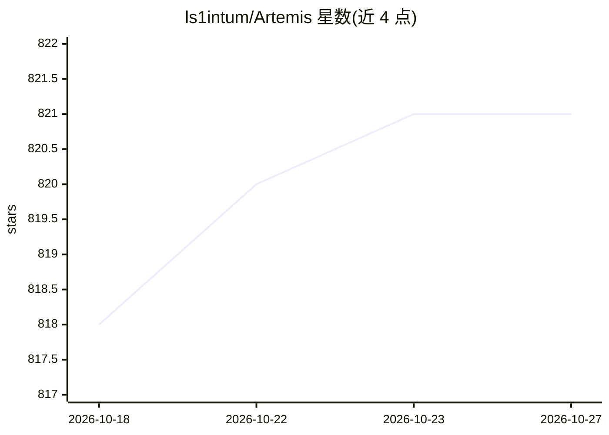

# ls1intum/Artemis

⭐ 821 · Java · MIT · 推送 2026-10-26 · [GitHub](https://github.com/ls1intum/Artemis) · [官网](https://docs.artemis.tum.de) · 组织维护

**高校自托管互动学习与自动反馈平台（含可选 AI）**

面向大学与学校的开源教学平台：提供编程（内置版本控制与 CI、20 种语言模板）、测验、建模、文本、文件上传五类练习，自动评阅与个人反馈，在线考试（变体题目、查重、学生复核）、适应式学习路径与分析，以及沟通、讲座、LTI/Moodle 集成和 iOS/Android 客户端。AI 部分（Iris 虚拟辅导、Athena 反馈建议、Hyperion 题目编写）为可选、配置门控的外部 EduTelligence 服务。自托管，Angular+Spring Boot，Docker Compose 或 Ansible 部署，TUM 维护。

## 筛选速览

| 维度 | 判定 | 备注 |
|---|---|---|
| AI 角色 | `ai-enhanced` | 去掉 AI 部分产品仍成立 |
| 许可风险 | `permissive` | MIT |
| 部署形态 | `self-host` | docker 或自建部署 |
| 模型依赖 | — | README 未给出锁定关系 |
| 硬件要求 | — | 无带数字的原话,不猜 |
| 安装摩擦 | `low` | 无编译、无系统依赖或容器化 |
| 成熟度 | — | 结构信号不足 |

## 能力要点

- 编程练习内置版本控制与 CI，可扩展构建容器内任意语言
- 考试模式含每人变体题目、测试运行、JPlag 查重与学生复核
- Iris/Athena/Hyperion 三项 AI 服务可选且配置门控，教师保留评阅责任
- 一条 Docker 命令即可本地试用，含可工作的编程练习

## 适用场景

- 高校大规模编程课程自动评阅与个别反馈
- 院系自行部署在线考试与适应性学习平台
- 在教学中使用 LLM 虚拟辅导与反馈建议（可选）

## 场景标签

 · 领域:教育技术

## 证据(README 行号)

> L35: - **Responsible AI support.** Iris, Athena, and Hyperion are optional, configuration-gated
> L106: Artemis integrates with the EduTelligence suite of
> L107: AI services. **Iris** is an LLM-based virtual tutor that guides students with hints and leading

## 星数曲线

2026-10-18 818 → 2026-10-27 821（+3）

---
*卡片 v1 · prompt 1.4 · 生成 2026-10-21 · 置信度 high · 依据 README sha `5ca22d92a3b4` · [字段定义](../../DATASET.md)*
