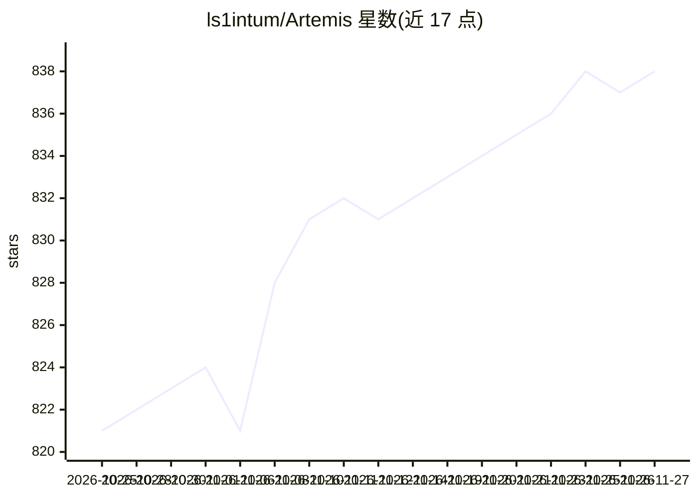

# ls1intum/Artemis

⭐ 838 · Java · MIT · 推送 2026-11-26 · [GitHub](https://github.com/ls1intum/Artemis) · [官网](https://docs.artemis.tum.de) · 组织维护

**高校自托管互动学习平台：练习自动反馈与考试管理**

面向大学与学校的开源互动学习平台，支持编程、建模、文本、测验、文件上传等练习类型，提交后自动构建、测试并给出反馈，或结合人工评阅与反馈建议。内置版本控制（LocalVC）与持续集成（LocalCI），提供考试模式、抄袭检测、胜任力与学习路径等自适应学习功能。架构为 Angular 客户端加 Spring Boot 服务端，数据存于 PostgreSQL，可水平扩展；AI 组件 Iris/Athena/Hyperion 均为可选、由配置门控，评阅决定权保留在教师与助教手中。

## 筛选速览

| 维度 | 判定 | 备注 |
|---|---|---|
| AI 角色 | `ai-enhanced` | 去掉 AI 部分产品仍成立 |
| 许可风险 | `permissive` | MIT |
| 部署形态 | `self-host` | docker 或自建部署 |
| 模型依赖 | — | README 未给出锁定关系 |
| 硬件要求 | — | 无带数字的原话,不猜 |
| 安装摩擦 | `low` | 无编译、无系统依赖或容器化 |
| 成熟度 | — | 结构信号不足 |

## 能力要点

- 编程提交自动构建、测试与分析并生成基于测试用例的反馈
- 内置 LocalVC 与 LocalCI，无需外部版本控制或 CI 系统
- 考试模式含每生练习变体、试运行与抄袭检测（JPlag）
- 可选 AI 集成 Iris（LLM 辅导）、Athena（反馈建议）、Hyperion（练习编写）

## 适用场景

- 大学为大规模编程课程提供自动评测与个性化反馈
- 在线组织带变体题目与抄袭检测的考试
- 通过胜任力与学习路径跟踪学生个体进度
- 接入 Moodle 等已有学习管理系统（LTI）

## 场景标签

 · 领域:教育技术/教学平台

## 证据(README 行号)

> L34: - **Responsible AI support.** Iris, Athena, and Hyperion are optional, configuration-gated
> L105: Artemis integrates with the EduTelligence suite of
> L109: optional and gated by configuration.

## 星数曲线

2026-10-25 821 → 2026-11-27 838（+17）

---
*卡片 v1 · prompt 1.4 · 生成 2026-11-26 · 置信度 high · 依据 README sha `f5e0544f63c2` · [字段定义](../../DATASET.md)*
