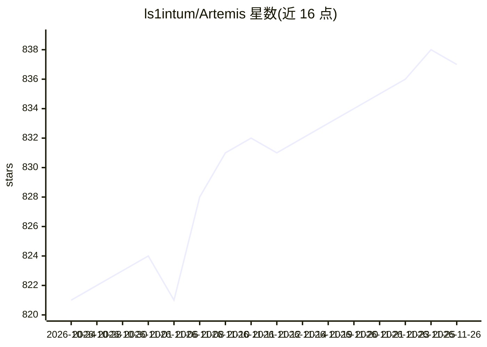

# ls1intum/Artemis

⭐ 837 · Java · MIT · 推送 2026-11-25 · [GitHub](https://github.com/ls1intum/Artemis) · [官网](https://docs.artemis.tum.de) · 组织维护

**面向高校的自托管交互式学习与自动反馈平台**

开源教学平台（MIT，Spring Boot + Angular），供高校在大规模课程中提供编程、建模、测验、文本、文件上传等练习的自动与人工评估。编程提交经内置版本控制（LocalVC）与持续集成（LocalCI）自动构建、测试并生成基于测试用例的反馈；支持考试模式、查重、能力图谱与学习路径。AI 组件（Iris 虚拟导师、Athena 反馈建议、Hyperion 练习编写）均为可选并需配置开启。需 PostgreSQL，Docker Compose 可一键试用，生产部署推荐 Ansible。

## 筛选速览

| 维度 | 判定 | 备注 |
|---|---|---|
| AI 角色 | `ai-enhanced` | 去掉 AI 部分产品仍成立 |
| 许可风险 | `permissive` | MIT |
| 部署形态 | `self-host` | docker 或自建部署 |
| 模型依赖 | — | README 未给出锁定关系 |
| 硬件要求 | — | 无带数字的原话,不猜 |
| 安装摩擦 | `low` | 无编译、无系统依赖或容器化 |
| 成熟度 | — | 结构信号不足 |

## 能力要点

- 编程练习自动构建、测试并生成基于测试用例的反馈
- 内置 LocalVC（Git 服务器）与 LocalCI（Docker 构建代理），无需外部 VCS/CI
- 支持 20 种语言模板的编程练习与考试模式、查重（JPlag）
- 可选 AI 服务：Iris 虚拟导师、Athena 反馈建议、Hyperion 练习编写

## 适用场景

- 高校为大规模编程课程提供自动评分与个性化反馈
- 组织带防作弊机制的在线考试
- 接入现有 LMS（通过 LTI，如 Moodle）
- 作为教育研究平台开展教学实验

## 场景标签

 · 领域:教育/教学平台

## 证据(README 行号)

> L34: - **Responsible AI support.** Iris, Athena, and Hyperion are optional, configuration-gated
> L108: **Hyperion** is Artemis-native AI-assisted exercise authoring built on Spring AI. All of them are
> L190: Artemis is decomposed into an application client (Angular) and an application server (Spring Boot).

## 星数曲线

2026-10-24 821 → 2026-11-26 837（+16）

---
*卡片 v1 · prompt 1.4 · 生成 2026-11-24 · 置信度 high · 依据 README sha `9bf546f1567d` · [字段定义](../../DATASET.md)*
