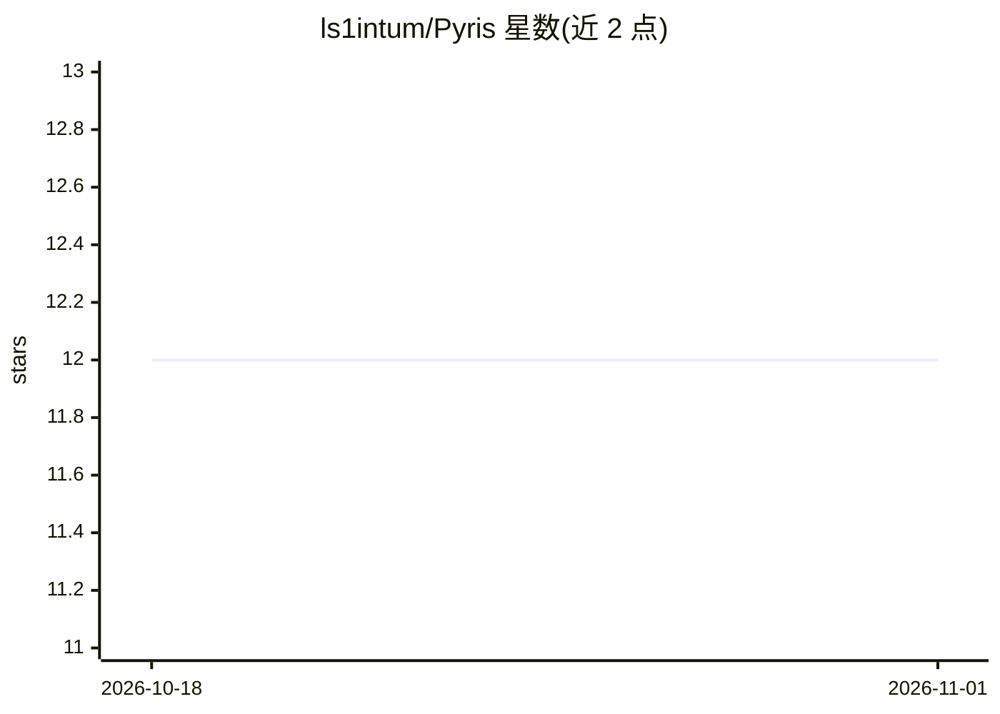

# ls1intum/Pyris

⭐ 12 · Python · MIT · 推送 2026-06-03 · [GitHub](https://github.com/ls1intum/Pyris) · 组织维护

**为学习平台 Artemis 接入多种 LLM 的中间层微服务**

Pyris 是连接 Artemis 教学平台与多个大语言模型的中间系统，通过 REST API 按任务调度不同 pipeline。当前驱动 Iris 虚拟 AI 助教，支持编程练习反馈（分析代码、反馈与构建日志）、基于 RAG 的课程内容讲解（Weaviate 向量库）与课程能力（competency）自动生成。模型经 llm_config.yml 声明能力（上下文长度、成本、隐私合规等）供按任务选型，支持 openai_chat、azure_chat、ollama 等客户端类型；多数 pipeline 要求 gpt_version_equivalent ≥ 4.5。本地需 Python 3.12，可 uvicorn 运行或 Docker Compose 部署（附 Nginx 生产方案）。

## 筛选速览

| 维度 | 判定 | 备注 |
|---|---|---|
| AI 角色 | `ai-ecosystem` | LLM/agent 周边工具 |
| 许可风险 | `permissive` | MIT |
| 部署形态 | `self-host` | docker 或自建部署 |
| 模型依赖 | local-ok | 支持本地模型 |
| 硬件要求 | — | 无带数字的原话,不猜 |
| 安装摩擦 | `low` | 无编译、无系统依赖或容器化 |
| 成熟度 | — | 结构信号不足 |

## 能力要点

- REST API 按任务调度 LLM pipeline，供 Artemis 平台调用
- Iris 助教：编程练习反馈、RAG 课程内容讲解、competency 自动生成
- 模型能力配置体系（上下文长度/成本/隐私合规/自托管等参数）
- Weaviate 向量库配套，Docker Compose 开发与生产部署方案

## 适用场景

- 为 Artemis 教学平台接入多个 LLM 提供统一服务
- 给学生提供编程练习反馈与课程内容问答的 AI 助教
- 自动生成课程 competency 减少手工工作

## 场景标签

`RAG` `模型网关` · 领域:Agent 开发

## 证据(README 行号)

> L3: Pyris is an intermediary system that connects the Artemis platform with various Large Language Models (LLMs). It pro
> L5: Currently, Pyris powers Iris, a virtual AI tutor that assists students with their programming exercises on Artemis i

## 星数曲线

2026-10-18 12 → 2026-11-01 12（+0）

---
*卡片 v1 · prompt 1.4 · 生成 2026-11-01 · 置信度 mid · 依据 README sha `051628865d6e` · [字段定义](../../DATASET.md)*
