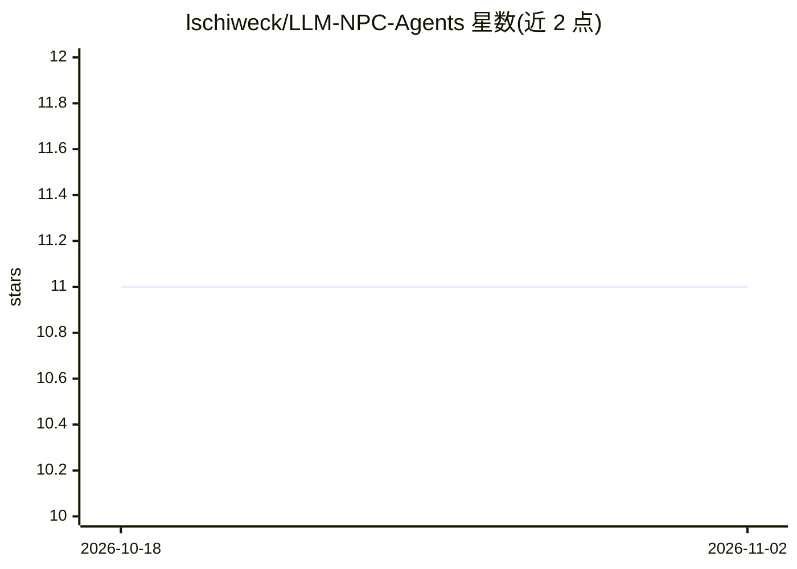

# lschiweck/LLM-NPC-Agents

⭐ 11 · Python · Apache-2.0 · 推送 2026-09-04 · [GitHub](https://github.com/lschiweck/LLM-NPC-Agents) · 个人维护

**面向游戏 NPC 的实时语音 AI 后端框架（STT+LLM+TTS）**

基于 KoljaB/RealtimeVoiceChat 修改的 Python/FastAPI 后端，为 Unity 等 VR/3D 客户端提供可对话的智能 NPC：支持 agent-玩家对话、agent 间对话、动态上下文注入，以及后台 AI Game Manager 周期性分析对话并注入指令驱动剧情。语音链路为 RealtimeSTT（Whisper）→ Ollama/OpenAI LLM → RealtimeTTS（Kokoro/Coqui/Orpheus），默认全部本地运行。角色由三层系统提示（不可改框架层+可编辑人格层+知识层）配置；README 声明需自行大量调校提示词，且为 Early Release、需 NVIDIA GPU（建议 8GB+ VRAM）方可获得可用延迟。提供 Conda 与 Docker 两种部署方式及 Unity 集成脚本，亦是 AID 论文（GI VR/AR Workshop 2026）的参考实现。

## 筛选速览

| 维度 | 判定 | 备注 |
|---|---|---|
| AI 角色 | `ai-ecosystem` | LLM/agent 周边工具 |
| 许可风险 | `permissive` | Apache-2.0 |
| 部署形态 | `self-host` | docker 或自建部署 |
| 模型依赖 | local-ok | 支持本地模型 |
| 硬件要求 | `gpu-8g` | |
| 安装摩擦 | `low` | 无编译、无系统依赖或容器化 |
| 成熟度 | `idea` | |

## 能力要点

- 多 NPC 并行编排与 agent 间自主对话（AID）
- AI Game Manager 后台分析对话并注入剧情指令（默认 30s 周期）
- 三层系统提示架构：框架层不可改，人格与游戏知识层 JSON 可编辑
- 默认全本地运行：Ollama LLM + 本地 STT/TTS，无需云 API

## 适用场景

- 为 VR/Unity 游戏开发可实时语音对话的智能 NPC
- 搭建 NPC 之间自主交谈、随剧情动态变化的侦探类游戏原型
- 复现论文中的 AID 机制（npc_conversation.py / prompt_layers.py / game_manager.py）

## 场景标签

`语音 Agent` `Agent 框架` · 领域:Agent 开发

## 证据(README 行号)

> L57: > ⚠️ **Important:** This project provides the framework and architecture for intelligent NPCs, but **prompt enginee
> L61: 1. **Backend (Python/FastAPI)** – Speech-to-Text, LLM inference, Text-to-Speech

## 星数曲线

2026-10-18 11 → 2026-11-02 11（+0）

---
*卡片 v1 · prompt 1.4 · 生成 2026-11-02 · 置信度 high · 依据 README sha `2a92cb39966e` · [字段定义](../../DATASET.md)*
