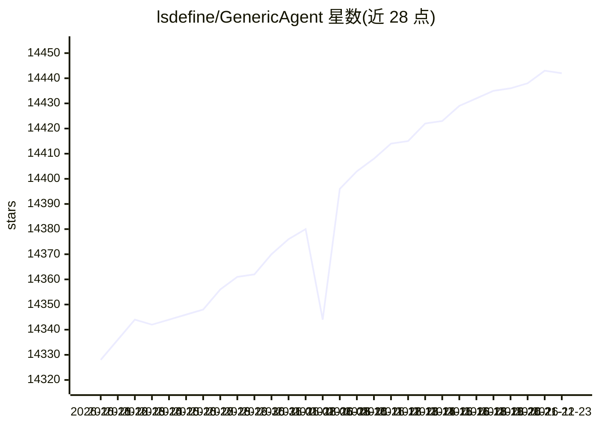

# lsdefine/GenericAgent

⭐ 14,442 · Python · MIT · 推送 2026-11-20 · [GitHub](https://github.com/lsdefine/GenericAgent) · [官网](https://github.com/lsdefine/GenericAgent) · 个人维护 · 中文 README

**自进化自主 agent 框架：LLM 接管电脑操作并沉淀技能**

以约 3K 行种子代码、9 个原子工具和约 100 行 Agent Loop 构成的自主 agent 框架，让接入的 LLM 控制本地系统的浏览器、终端、文件、键鼠、屏幕视觉与 ADB 移动设备。每次完成新任务会把执行路径固化为可复用 Skill，形成个人技能树；采用 L0-L4 分层记忆系统存储规则、事实、SOP 与会话归档。核心依赖仅 requests 等少量包，提供 TUI、Streamlit UI 及 Telegram/Discord/飞书等 IM 前端，需自行填写 LLM API key。预置 SOP 为中文。

## 筛选速览

| 维度 | 判定 | 备注 |
|---|---|---|
| AI 角色 | `ai-ecosystem` | LLM/agent 周边工具 |
| 许可风险 | `permissive` | MIT |
| 部署形态 | `desktop` | 安装包/桌面程序 |
| 模型依赖 | — | README 未给出锁定关系 |
| 硬件要求 | — | 无带数字的原话,不猜 |
| 安装摩擦 | `low` | 无编译、无系统依赖或容器化 |
| 成熟度 | `idea` | |

## 动量与使用信号

- 维护:`active` — 距上次 push 1.9 天,年发版 6,67 位贡献者
- 涨星:近 1 天 **+5**(自 20261016 起算)
- 安装:pypi 包 `prompt_toolkit` 月下载无数据
- 平台:— · 协议:MCP

## 能力要点

- 9 个原子工具（code_run/file_read/web_scan 等）+ 约 100 行 Agent Loop
- 任务执行路径自动结晶为 Skill，形成自进化技能树
- L0-L4 分层记忆系统与 <30K 上下文窗口设计
- 支持 TUI、Streamlit、Telegram/Discord/飞书等前端

## 适用场景

- 让 agent 自动操作浏览器和桌面完成下单、报账等任务
- 通过对话逐步解锁网页自动化、OCR、视觉、computer use 能力
- 让 agent 安装依赖、写脚本并定时执行监控/摘要任务
- 在 IM（Telegram/Discord/飞书）中远程驱动本地 agent

## 场景标签

`Agent 框架` `Agent 记忆` `浏览器自动化` `GUI 自动化` · 领域:Agent 开发

## 证据(README 行号)

> L23: **GenericAgent** is a minimal, self-evolving autonomous agent framework. Its core is just **~3K lines of code**. Th
> L42: |🔌 **High Compatibility**|Supports Claude / Gemini / Kimi / MiniMax and other major models. Cross-platform.|
> L98: Dependencies are deliberately tiered: the agent core needs only `requests`, plus four lightweight packages (`beauti

## 星数曲线

2026-10-21 14,328 → 2026-11-23 14,442（+114）

---
*卡片 v1 · prompt 1.4 · 生成 2026-11-22 · 置信度 mid · 依据 README sha `3688c52e79b6` · [字段定义](../../DATASET.md)*
