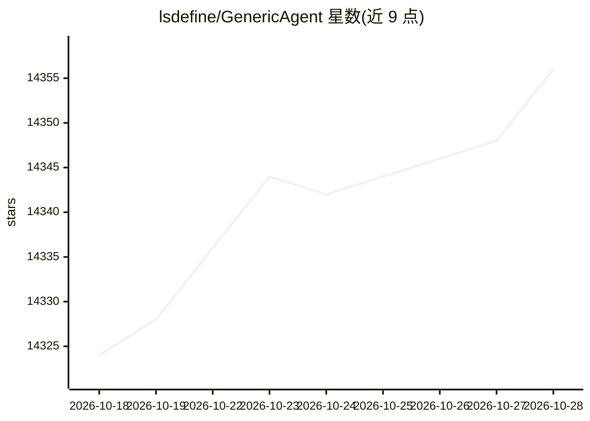

# lsdefine/GenericAgent

⭐ 14,356 · Python · MIT · 推送 2026-10-27 · [GitHub](https://github.com/lsdefine/GenericAgent) · [官网](https://github.com/lsdefine/GenericAgent) · 个人维护 · 中文 README

**自进化 Agent 框架：从约3K行种子代码生长个人技能树**

以约3K行种子代码、9个原子工具和约100行 Agent Loop 构成的自主 Agent 框架，赋予 LLM 对本地计算机的系统级控制，覆盖浏览器、终端、文件系统、键鼠输入、屏幕视觉与 ADB 移动设备。每次完成新任务会把执行路径固化为可复用 Skill，形成个人技能树；配套 L0-L4 分层记忆系统与 TUI/Streamlit/IM 多种前端。需配置 LLM API key，Python 限定 3.11/3.12。预置 SOP 以中文撰写，核心依赖刻意精简。

## 筛选速览

| 维度 | 判定 | 备注 |
|---|---|---|
| AI 角色 | `ai-native` | 本体是模型或模型工具 |
| 许可风险 | `permissive` | MIT |
| 部署形态 | `desktop` | 安装包/桌面程序 |
| 模型依赖 | — | README 未给出锁定关系 |
| 硬件要求 | — | 无带数字的原话,不猜 |
| 安装摩擦 | `low` | 无编译、无系统依赖或容器化 |
| 成熟度 | — | 结构信号不足 |

## 动量与使用信号

- 维护:`active` — 距上次 push 1.9 天,年发版 6,67 位贡献者
- 涨星:近 1 天 **+5**(自 20261016 起算)
- 安装:pypi 包 `prompt_toolkit` 月下载无数据
- 平台:— · 协议:MCP

## 能力要点

- 任务执行路径自动固化为可复用 Skill，形成个人技能树
- 9 个原子工具 + 约100行核心 Agent Loop（agent_loop.py）
- L0-L4 分层记忆系统沉淀经验与 SOP
- 支持 Telegram/Discord/Lark 等 IM 前端接入

## 适用场景

- 让 Agent 代为操作浏览器与本地软件完成日常任务
- 通过对话让 Agent 自动安装依赖并固化重复工作流
- 用 ADB 驱动手机完成查账、发消息等操作

## 场景标签

`Agent 框架` `Agent 记忆` `浏览器自动化` `GUI 自动化` · 领域:Agent 开发

## 证据(README 行号)

> L23: **GenericAgent** is a minimal, self-evolving autonomous agent framework. Its core is just **~3K lines of code**. Th
> L39: |🧬 **Self-Evolving**|Automatically crystallizes each task into a Skill. Capabilities grow with every use, forming y

## 星数曲线

2026-10-18 14,324 → 2026-10-28 14,356（+32）

---
*卡片 v1 · prompt 1.4 · 生成 2026-10-18 · 置信度 mid · 依据 README sha `fb426637e9ed` · [字段定义](../../DATASET.md)*
