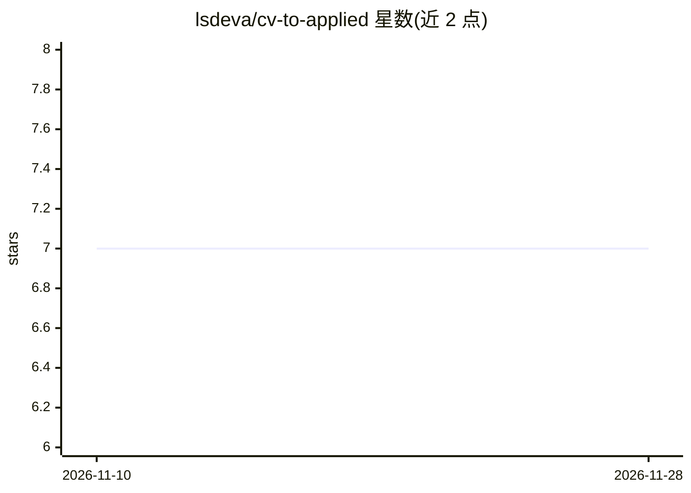

# lsdeva/cv-to-applied

⭐ 7 · Python · MIT · 推送 2026-11-08 · [GitHub](https://github.com/lsdeva/cv-to-applied) · 个人维护

**求职者用 Claude Code 本地自动定制并提交职位申请**

运行在本地电脑的开源求职申请自动化工具：读取用户 CV 与目标国家，自动搭建环境、生成候选人画像、搜索匹配职位并排序、为每个职位定制 CV 与求职信，并通过 Playwright 驱动浏览器填写提交申请。首个申请需用户确认后才继续，遇 CAPTCHA、登录或验证码时暂停交还用户。依赖 VS Code 的 Claude Code 扩展及包含 Claude Code 的 Claude 账户。表单填写辅助代理运行在较轻的 Sonnet 模型上以控制成本；数据保存在本地，密码存入系统钥匙串。

## 筛选速览

| 维度 | 判定 | 备注 |
|---|---|---|
| AI 角色 | `ai-native` | 本体是模型或模型工具 |
| 许可风险 | `permissive` | MIT |
| 部署形态 | `None` |  |
| 模型依赖 | locked-api |  |
| 硬件要求 | — | 无带数字的原话,不猜 |
| 安装摩擦 | `low` | 无编译、无系统依赖或容器化 |
| 成熟度 | — | 结构信号不足 |

## 能力要点

- 一条提示词完成从 CV 到提交申请的端到端流程
- 多辅助代理（起草/审阅/填表/问答）分摊任务降低 token 成本
- 按平台积累 playbook 学习各求职网站表单细节，答案复用避免重复提问
- 忽略职位页面隐藏的提示注入内容，密码存系统钥匙串不入文件

## 适用场景

- 批量向目标国家的匹配职位投递定制化 CV 与求职信
- 保留人工确认节点的前提下自动填写各招聘平台的申请表
- 复用已有账号的求职者希望自动生成定制简历和求职信

## 场景标签

`浏览器自动化` `AI 写作` · 领域:效率与自动化

## 证据(README 行号)

> L9: **An open-source job application autopilot that runs on your own laptop.** Attach your CV, name the
> L23: It's built on Claude Code and customizes the
> L50: - **Model:** tested with **Claude Opus 5.5 at medium effort** as the main model (pick it with `/model`

## 星数曲线

2026-11-10 7 → 2026-11-28 7（+0）

---
*卡片 v1 · prompt 1.4 · 生成 2026-11-20 · 置信度 high · 依据 README sha `d791099de357` · [字段定义](../../DATASET.md)*
