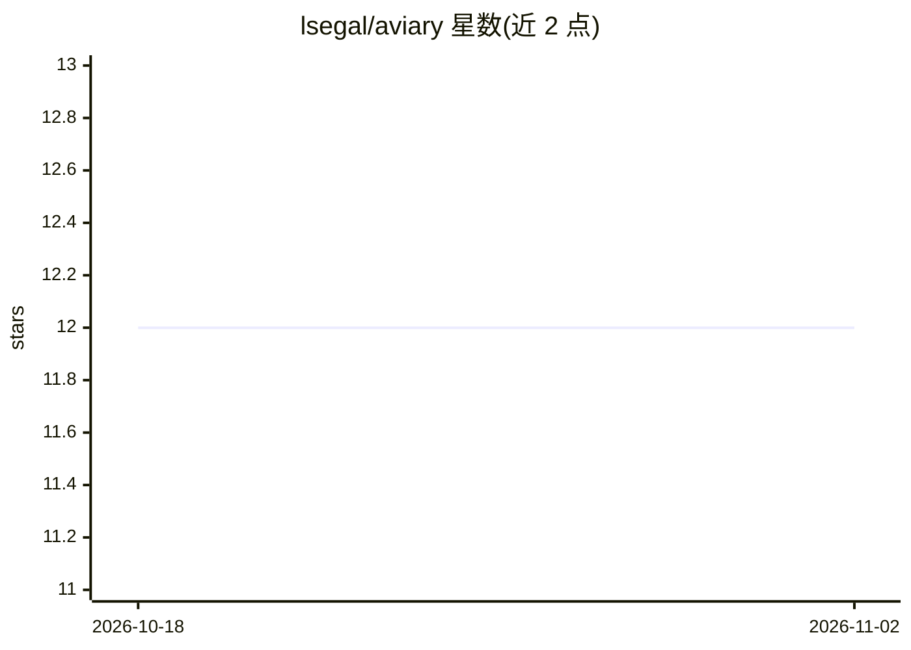

# lsegal/aviary

⭐ 12 · Go · MIT · 推送 2026-10-30 · [GitHub](https://github.com/lsegal/aviary) · [官网](https://aviary.bot) · 个人维护

**将 AI 模型接入聊天平台并执行定时任务的助手平台**

Aviary 是一个 AI 助手平台：把用户的 AI 模型连接到 Slack、Signal、Discord 等聊天渠道进行对话，支持 cron 与文件监听两类定时任务，代理可在服务端执行工作（Docker 镜像内置 Chrome/Chromium，浏览器任务可无头运行）。管理方式包括 CLI 和 Web 控制面板（默认 https://localhost:16677），配置通过 aviary.yaml 定义 providers、agents、channels、tasks，并支持 MCP 工具。安装途径覆盖 Homebrew、cURL 脚本、Scoop、PowerShell 脚本、Docker、二进制与 go install。

## 筛选速览

| 维度 | 判定 | 备注 |
|---|---|---|
| AI 角色 | `ai-native` | 本体是模型或模型工具 |
| 许可风险 | `permissive` | MIT |
| 部署形态 | `desktop` | 安装包/桌面程序 |
| 模型依赖 | — | README 未给出锁定关系 |
| 硬件要求 | — | 无带数字的原话,不猜 |
| 安装摩擦 | `low` | 无编译、无系统依赖或容器化 |
| 成熟度 | — | 结构信号不足 |

## 能力要点

- 接入 Slack/Signal/Discord 等多聊天渠道与模型对话
- cron 与文件监听两类定时任务调度
- CLI 与 Web 控制面板双管理入口
- Docker 镜像内置 Chrome/Chromium，浏览器任务开箱即无头运行

## 适用场景

- 把自己的 AI 模型接到 Slack 或 Discord 上对话
- 让代理按 cron 计划自动执行任务
- 通过 Web 面板集中管理多个 agent 与渠道配置

## 场景标签

`AI 助手` `浏览器自动化` · 领域:效率与自动化

## 证据(README 行号)

> L9: Aviary is a full AI assistant platform. Connect your AI models to Slack, Signal, Discord, and more. Have conversatio
> L105: |Configuration|`aviary.yaml` walkthrough — providers, agents, channels, tasks|

## 星数曲线

2026-10-18 12 → 2026-11-02 12（+0）

---
*卡片 v1 · prompt 1.4 · 生成 2026-11-01 · 置信度 high · 依据 README sha `1f873b6272ba` · [字段定义](../../DATASET.md)*
