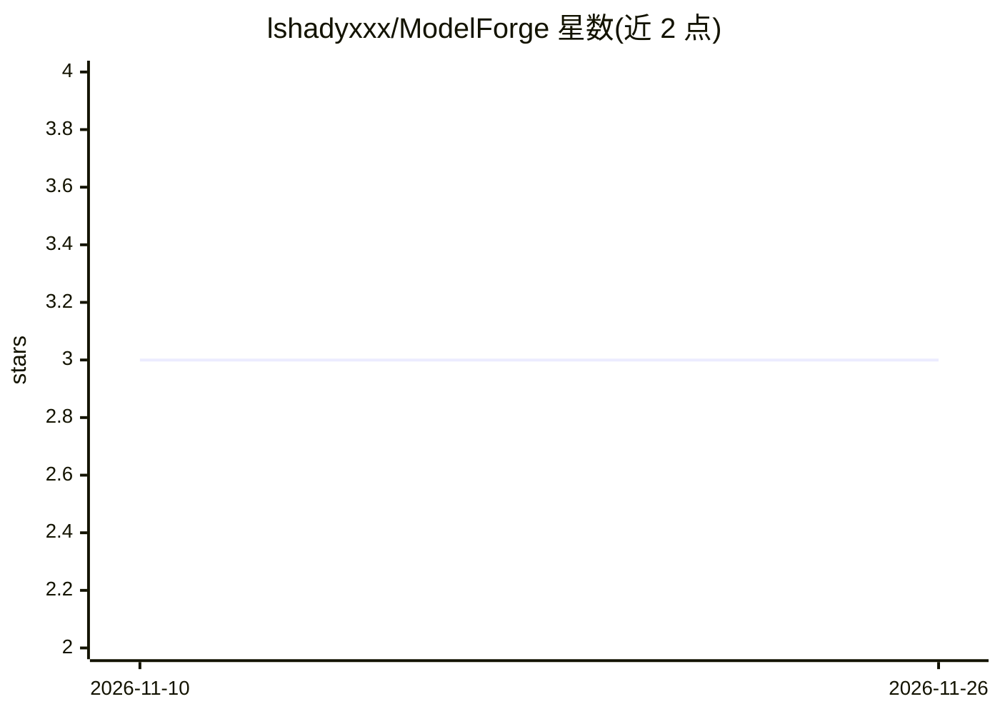

# lshadyxxx/ModelForge

⭐ 3 · Python · Apache-2.0 · 推送 2026-11-21 · [GitHub](https://github.com/lshadyxxx/ModelForge) · 个人维护 · 中文 README

**面向训练/推理交付流程的模型工程工作台**

开源的模型训练与推理全生命周期工作台：把数据集版本、训练预检、运行指标、失败现场、模型产物与独立推理验收组织成证据链，并附加 advisory 级 AI 训练诊断层，输出带证据引用的分级发现与下一轮实验建议。技术栈为 React/FastAPI/PostgreSQL/MinIO，训练运行时基于 LLaMA-Factory，推理走独立 vLLM 生命周期。以 Docker Compose 单机编排启动，无用户登录与多租户隔离，不适用于直接公网暴露。

## 筛选速览

| 维度 | 判定 | 备注 |
|---|---|---|
| AI 角色 | `ai-ecosystem` | LLM/agent 周边工具 |
| 许可风险 | `permissive` | Apache-2.0 |
| 部署形态 | `self-host` | docker 或自建部署 |
| 模型依赖 | local-ok | 支持本地模型 |
| 硬件要求 | — | 无带数字的原话,不猜 |
| 安装摩擦 | `low` | 无编译、无系统依赖或容器化 |
| 成熟度 | — | 结构信号不足 |

## 能力要点

- 训练产物交付闭环：Best/Final Adapter、Manifest、SHA-256 回读与独立推理验收
- AI 训练诊断生成带可追溯证据引用的结构化报告，advisory 不替代硬门禁
- 历史训练对比：同基座/数据集/split 的运行间参数与信号比较
- vLLM 独立推理运行时记录健康、流式输出与清理结果

## 适用场景

- 为团队 LoRA/SFT 训练流程建立可追溯的版本与产物管理
- 训练完成后对产物做独立推理验收再决定是否交付
- 用 AI 诊断报告定位训练异常并规划下一轮实验

## 场景标签

`微调` `MLOps` · 领域:训练与推理

## 证据(README 行号)

> L5: ModelForge 是面向模型训练与推理全生命周期的开源工程工作台。它把数据集、版本、训练预检、
> L47: |训练运行时|远程 GPU 执行器、固定 runtime contract、LLaMA-Factory|
> L49: |AI 编排|LangGraph、`langchain-openai`、PostgreSQL checkpoint|

## 星数曲线

2026-11-10 3 → 2026-11-26 3（+0）

---
*卡片 v1 · prompt 1.4 · 生成 2026-11-21 · 置信度 high · 依据 README sha `fb2e27a57d73` · [字段定义](../../DATASET.md)*
