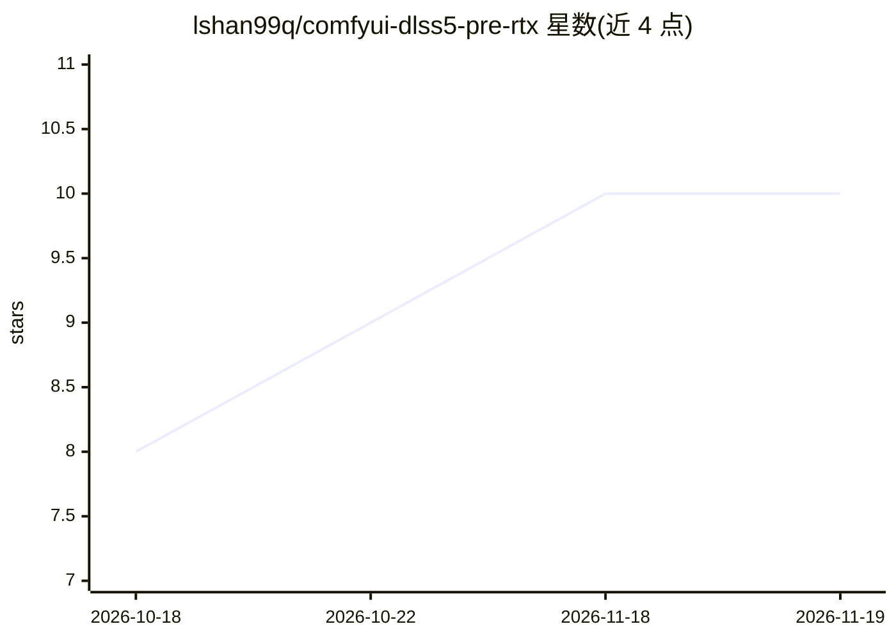

# lshan99q/comfyui-dlss5-pre-rtx

⭐ 10 · Python · MIT · 推送 2026-10-01 · [GitHub](https://github.com/lshan99q/comfyui-dlss5-pre-rtx) · 个人维护 · 中文 README

**让非 RTX NVIDIA 卡在 ComfyUI 运行 DLSS 5 神经渲染**

一个 ComfyUI 自定义节点包，将 DLSS 5 神经渲染网络经逆向工程重实现为纯 PyTorch 推理，不经过 NGX/D3D12/Wine，从而在官方插件拒绝的 Volta/Pascal/Maxwell 架构上运行。提供图像增强、视频增强（内置 OpenCV DIS 光流运动估计）与缓存清理四个节点，界面随 ComfyUI 语言设置切换中英文。安装脚本需用户自备 nvngx_dlssnr.dll 并转换为 safetensors 检查点；仅在 Tesla V100 上端到端验证，质量为 DLSS-5-like 重实现，与 NVIDIA 原始输出未建立数值等价。

## 筛选速览

| 维度 | 判定 | 备注 |
|---|---|---|
| AI 角色 | `ai-native` | 本体是模型或模型工具 |
| 许可风险 | `permissive` | MIT |
| 部署形态 | `None` |  |
| 模型依赖 | — | README 未给出锁定关系 |
| 硬件要求 | — | 无带数字的原话,不猜 |
| 安装摩擦 | `medium` | 含编译或系统依赖之一 |
| 成熟度 | — | 结构信号不足 |

## 能力要点

- 纯 PyTorch 推理路径，不调用 NGX/D3D12/ReShade/Wine
- 视频节点内置 OpenCV DIS 光流运动估计，VIDEO in→VIDEO out
- 设备可选 auto/cuda/cpu/mps，附安装与推理验证脚本
- locales/ 目录按 ComfyUI 语言设置提供中文界面

## 适用场景

- 在 Tesla V100 等非 RTX 卡上对图像做神经渲染增强
- 在 ComfyUI 视频工作流 LoadVideo 与 SaveVideo 之间插入增强节点
- 验证非 NGX 路径下 DLSS 5 类网络能否在旧架构 GPU 运行

## 场景标签

`图像视频处理` · 领域:感知与多模态

## 证据(README 行号)

> L13: Every DLSS 5 node pack in circulation drives NVIDIA's native NGX runtime through D3D12, which
> L39:  The pack installs under <code>DLSS 5/PyTorch (experimental)</code> — Model Loader → Neural
> L89: The network has been reverse-engineered and reimplemented in portable PyTorch. Nothing in the

## 星数曲线

2026-10-18 8 → 2026-11-19 10（+2）

---
*卡片 v1 · prompt 1.4 · 生成 2026-11-19 · 置信度 high · 依据 README sha `b102d439aa99` · [字段定义](../../DATASET.md)*
