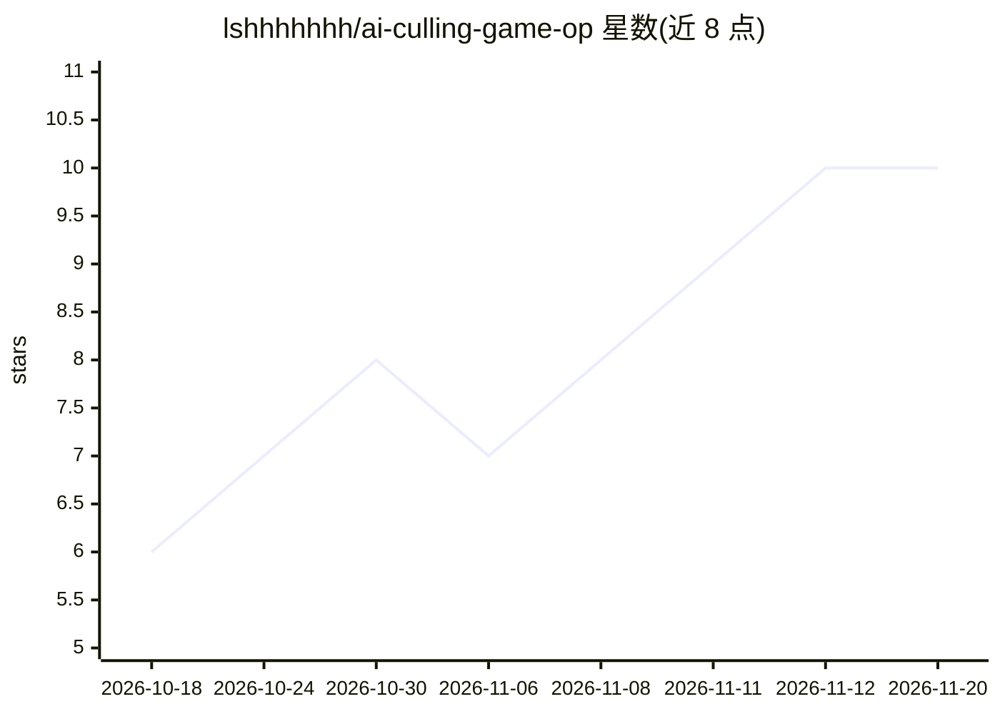

# lshhhhhhh/ai-culling-game-op

⭐ 10 · Python · NOASSERTION · 推送 2026-10-03 · [GitHub](https://github.com/lshhhhhhh/ai-culling-game-op) · 个人维护 · 中文 README

**公开 AI 重制《咒术回战》OP 的做法、代码与提示词**

作者公开整支 90.1 秒 AI 版《咒术回战》第三季 OP 的制作过程：思路总结、研究代码、20 张人设图与生图提示词。核心做法是按镜头类型分流——摇镜头/推镜头拼整画后用生图模型重画并以代码重新模拟镜头运动，静止与局部变化镜头逐张生图后贴回，其余交给 MiniMax H3 视频编辑。代码为研究用途、未整理成通用工具，运行要求 Windows、Python 3.12、ffmpeg、ComfyUI 与 Codex 命令行，原片需自备。仓库不含原作画面、生成视频或音乐。

## 筛选速览

| 维度 | 判定 | 备注 |
|---|---|---|
| AI 角色 | `ai-knowledge` | 知识聚合/清单类 |
| 许可风险 | `none` | NOASSERTION |
| 部署形态 | `None` |  |
| 模型依赖 | — | README 未给出锁定关系 |
| 硬件要求 | — | 无带数字的原话,不猜 |
| 安装摩擦 | `medium` | 含编译或系统依赖之一 |
| 成熟度 | — | 结构信号不足 |

## 能力要点

- 103 个验收单元的完整提示词与合成说明公开
- 摇镜头/推镜头的「生图重画+代码重拍」替代方案
- 70 个单元用本地 MiniMax H3，28 个不用视频模型
- ComfyUI 提交校验、夜间队列等共用模块

## 适用场景

- 复现或借鉴 AI 动画 OP 的分镜级工作流
- 了解哪些镜头类型不必交给视频模型
- 参考人设图与生图提示词的写法

## 场景标签

`图像生成` `视频生成` · 领域:内容生成

## 证据(README 行号)

> L7: 这个仓库公开的是**做法**：思路总结、全部代码、本作绘制的人设图和生图提示词、每个单元最终用的提示词或合成说明。**不包含**任何原作画面、生成视频或音乐。
> L51: `pipelines/jujutsu/` 是实际跑通整片的研究代码，没有整理成通用工具，按思路对照着读：

## 星数曲线

2026-10-18 6 → 2026-11-20 10（+4）

---
*卡片 v1 · prompt 1.4 · 生成 2026-11-19 · 置信度 high · 依据 README sha `d752becbbe9e` · [字段定义](../../DATASET.md)*
