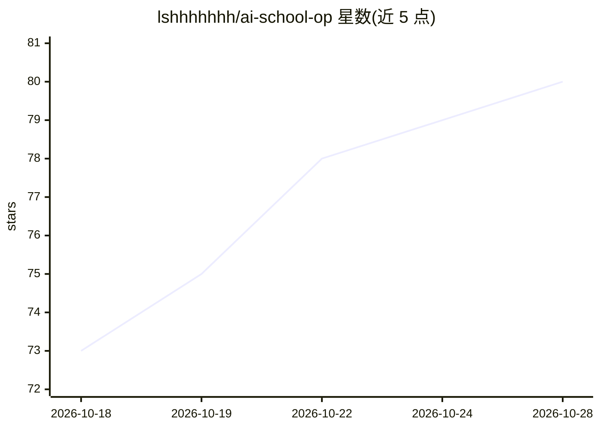

# lshhhhhhh/ai-school-op

⭐ 81 · Python · NOASSERTION · 推送 2026-09-25 · [GitHub](https://github.com/lshhhhhhh/ai-school-op) · 个人维护 · 中文 README

**AI 翻拍动画 OP 的制作过程开源：分镜、提示词与流水线代码**

粉丝二创项目：将《败犬女主太多了！》NCOP 的 18 位角色替换为各家大模型拟人 AI 娘。仓库公开做法而非成片素材——81 镜分镜计划、每镜最终通过的提示词、18 位 AI 娘人设图与生成提示词、完整演员表，以及整条流水线代码与 ComfyUI 工作流。流程为切分镜→本地 MiniMax H3 逐镜人物替换（人工逐镜验收）→按原时间轴拼接→超分（最终用 Topaz Astra 2）。代码为研究性质，未整理成通用工具，运行需 Windows、Python 3.12、ffmpeg、ComfyUI 与 MiniMax H3 模型，原片需自备。

## 筛选速览

| 维度 | 判定 | 备注 |
|---|---|---|
| AI 角色 | `ai-native` | 本体是模型或模型工具 |
| 许可风险 | `none` | NOASSERTION |
| 部署形态 | `None` |  |
| 模型依赖 | — | README 未给出锁定关系 |
| 硬件要求 | — | 无带数字的原话,不猜 |
| 安装摩擦 | `medium` | 含编译或系统依赖之一 |
| 成熟度 | — | 结构信号不足 |

## 能力要点

- 81 镜分镜计划与逐镜最终通过的提示词全部公开
- 本地 MiniMax H3 视频编辑流水线（提交 ComfyUI、温度保护、逐镜验收页面）
- 18 位 AI 娘人设图（GPT 生图）与生成提示词
- 对比 SeedVR2、AnimeJaNai、Real-CUGAN、Topaz 多种超分方案

## 适用场景

- 学习 AI 视频逐镜替换与批量生成的完整流程
- 复用提示词写法与 ComfyUI 工作流做类似二创
- 查阅 AI 娘人设设计与演员表设定

## 场景标签

`视频生成` `提示工程` · 领域:Agent 开发

## 证据(README 行号)

> L24: |2. 逐镜人物替换|本地 MiniMax H3 做视频编辑：原镜头 + AI 娘人设图 → 换人换字的新镜头；人工逐镜验收，不行就改提示词重跑|docs/02-人物替换.md|
> L41: - `render_school_full_op.py`：批量生成主程序（提交 ComfyUI、GPU 温度保护、帧数和音轨校验）

## 星数曲线

2026-10-18 73 → 2026-10-28 80（+7）

---
*卡片 v1 · prompt 1.4 · 生成 2026-10-24 · 置信度 high · 依据 README sha `52ff4e1ed90e` · [字段定义](../../DATASET.md)*
