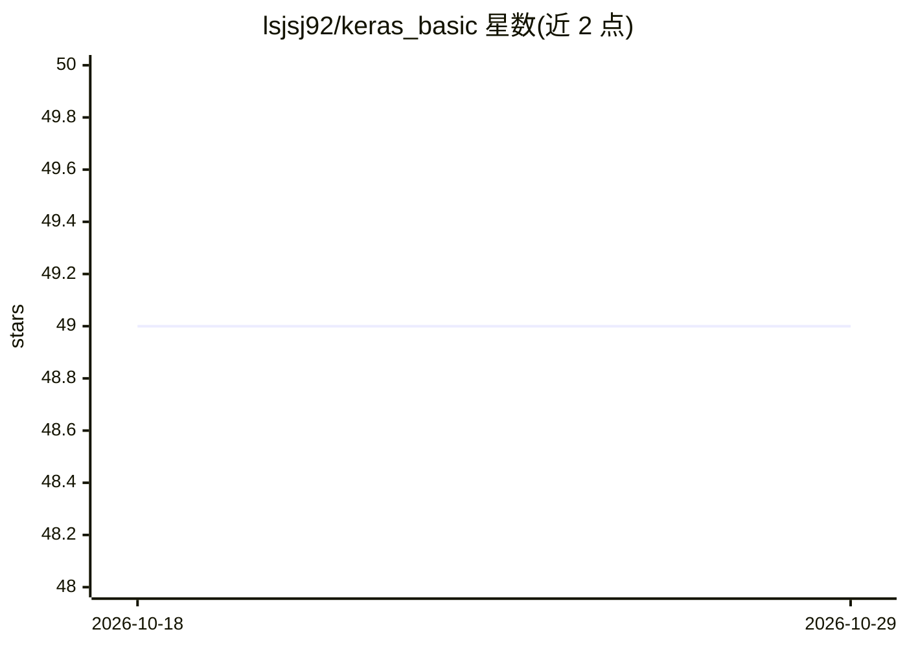

# lsjsj92/keras_basic

⭐ 49 · Jupyter Notebook · 推送 2026-03-11 · [GitHub](https://github.com/lsjsj92/keras_basic) · 个人维护

**Keras 深度学习基础教学示例集（韩文）**

面向深度学习初学者的 Keras 实践教程仓库，以 Jupyter Notebook 形式提供约 11 个示例：涵盖 GPU 使用方法、多层感知机的多/单分类（iris、红酒/白酒）、回归（波士顿房价）、MNIST 手写数字（MLP 与 CNN）、CNN 图像二分类与多分类（狗/猫）、LSTM 文本分类（垃圾邮件、韩语新闻分类）以及韩语电影评论文本分类。README 为韩文，未给出安装命令与运行说明，需读者自行搭建 Keras 环境后逐个运行 notebook。

## 筛选速览

| 维度 | 判定 | 备注 |
|---|---|---|
| AI 角色 | `ai-knowledge` | 知识聚合/清单类 |
| 许可风险 | `none` | — |
| 部署形态 | `None` |  |
| 模型依赖 | — | README 未给出锁定关系 |
| 硬件要求 | — | 无带数字的原话,不猜 |
| 安装摩擦 | `low` | 无编译、无系统依赖或容器化 |
| 成熟度 | — | 结构信号不足 |

## 能力要点

- 约 11 个 Jupyter Notebook 示例，覆盖 MLP/CNN/LSTM 三类模型
- 包含 GPU 使用示例（keras_gpu_test.ipynb）
- 含回归、图像分类、文本分类等多类任务
- 含韩语数据集（新闻分类、电影评论）示例

## 适用场景

- 跟随 notebook 学习 Keras 深度学习基础
- 参考 CNN/LSTM 在图像与文本分类上的实现
- 了解 Keras 中 GPU 使用方法

## 场景标签

`教程课程` · 领域:学习与行业

## 证据(README 行号)

> L4: keras 기본서
> L7: - 다층 퍼셉트론을 이용한 다중 분류 iris-data 구분(1. predict_iris_data.ipynb)

## 星数曲线

2026-10-18 49 → 2026-10-29 49（+0）

---
*卡片 v1 · prompt 1.4 · 生成 2026-10-25 · 置信度 high · 依据 README sha `c022367e6a69` · [字段定义](../../DATASET.md)*
