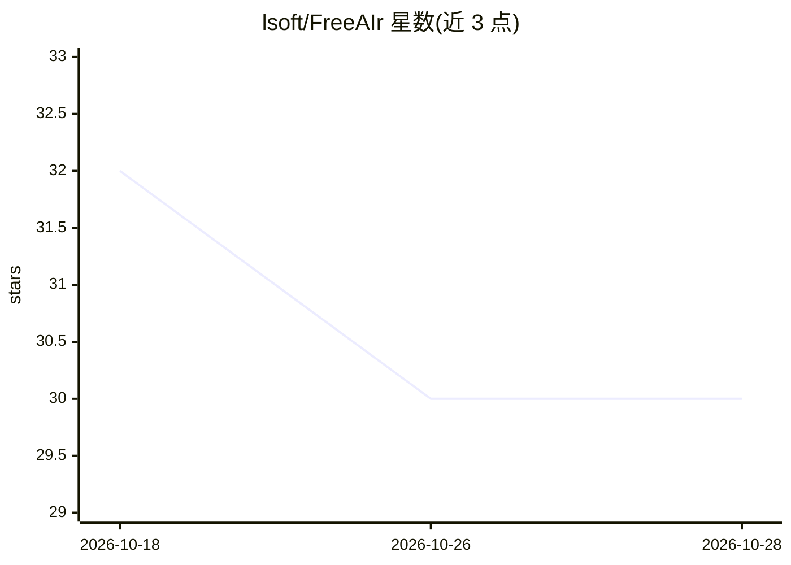

# lsoft/FreeAIr

⭐ 30 · C# · MIT · 推送 2026-09-22 · [GitHub](https://github.com/lsoft/FreeAIr) · [官网](https://github.com/lsoft/FreeAIr) · 个人维护 · 中文 README

**Visual Studio 2022/2026 扩展：免费接入任意 OpenAI 兼容或 Anthropic LLM**

面向 Visual Studio 2022（17.14+）与 2026 用户的 VSIX 扩展，通过 OpenAI 兼容 API 或 Anthropic 自有 API 与任意 LLM 对话，支持 LM Studio、KoboldCpp、Ollama 等本地推理。功能包括工具窗口与光标处 in situ 聊天、语音输入（4 种语音转文本后端）、自然语言代码搜索（RAG）、代码解释/注释/续写、整行补全、生成单元测试、修复构建错误、MCP 服务器支持（内置 Visual Studio MCP 服务器与 MSDN MCP 支持）。经 Visual Studio Marketplace 或 VSIX 安装，需 .NET 9 运行时；提供首运行设置向导，配置以 JSON 文件存于解决方案旁并可提交 git。

## 筛选速览

| 维度 | 判定 | 备注 |
|---|---|---|
| AI 角色 | `ai-native` | 本体是模型或模型工具 |
| 许可风险 | `permissive` | MIT |
| 部署形态 | `None` |  |
| 模型依赖 | locked-api |  |
| 硬件要求 | — | 无带数字的原话,不猜 |
| 安装摩擦 | `medium` | 含编译或系统依赖之一 |
| 成熟度 | — | 结构信号不足 |

## 能力要点

- 接入任意 OpenAI 兼容 API 或 Anthropic 自有 API，含本地 LLM（LM Studio/KoboldCpp/Ollama 等）
- 代码解释、注释续写、整行补全、单元测试生成、构建错误修复
- 自然语言代码搜索（RAG 支持）与语音输入（4 种后端，含全本地）
- MCP 服务器与工具支持，内置 Visual Studio MCP 服务器，支持 MSDN MCP

## 适用场景

- 在 Visual Studio 里用自选的远程或本地 LLM 做代码对话与补全
- 无法使用远程 API 时通过 KoboldCpp 等本地模型完成编码辅助
- 用自然语言搜索代码库并生成提交说明

## 场景标签

`代码生成` · 领域:编码与开发

## 证据(README 行号)

> L11: FreeAIr is a Visual Studio extension which allows you to interact with any LLM which have OpenAI-compatible API, or
> L35: - Chat with any OpenAI-compatible LLM, or with Claude through Anthropic's own API, in a tool window or in a small f

## 星数曲线

2026-10-18 32 → 2026-10-28 30（-2）

---
*卡片 v1 · prompt 1.4 · 生成 2026-10-26 · 置信度 high · 依据 README sha `daf275410ff9` · [字段定义](../../DATASET.md)*
