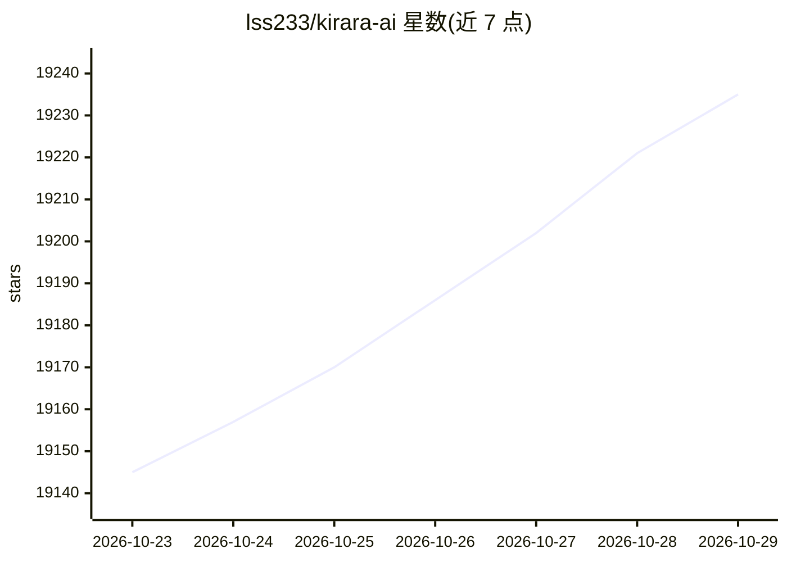

# lss233/kirara-ai

⭐ 19,235 · Python · AGPL-3.0 · 推送 2026-10-22 · [GitHub](https://github.com/lss233/kirara-ai) · [官网](https://kirara-docs.app.lss233.com/) · 个人维护 · 中文 README

**接入多平台多模型的可 DIY 聊天机器人**

面向聊天平台用户的机器人框架：支持 QQ、Telegram、Discord、微信、企业微信、飞书等平台，可接入 OpenAI、DeepSeek、Claude、Gemini、Qwen、Mistral、豆包、Minimax、Kimi 等模型。提供 WebUI 管理后台、插件市场、自定义工作流、人格预设、Stable Diffusion/Flux/Midjourney 绘图、语音回复（Azure/VITS）与 HTTP API 供外部接入，内置 Frpc 内网穿透。以 PyPI 包和 Docker 镜像分发。

## 筛选速览

| 维度 | 判定 | 备注 |
|---|---|---|
| AI 角色 | `ai-native` | 本体是模型或模型工具 |
| 许可风险 | `viral` | AGPL-3.0 |
| 部署形态 | `self-host` | docker 或自建部署 |
| 模型依赖 | locked-api |  |
| 硬件要求 | — | 无带数字的原话,不猜 |
| 安装摩擦 | `low` | 无编译、无系统依赖或容器化 |
| 成熟度 | — | 结构信号不足 |

## 能力要点

- 支持 QQ/Telegram/微信/Discord 等多聊天平台与多账号
- 接入 OpenAI/DeepSeek/Claude/Gemini/Qwen 等主流大模型
- WebUI、插件市场与自定义工作流
- 提供 HTTP API 与 Azure/VITS 语音回复

## 适用场景

- 在 QQ/微信/Telegram 群里部署 AI 聊天机器人
- 通过预设系统定制猫娘等聊天风格
- 以 HTTP API 将机器人接入自定义平台

## 场景标签

`聊天机器人` `图像生成` · 领域:对话与助手

## 证据(README 行号)

> L3:  一款支持主流大语言模型、主流聊天平台的聊天的机器人！
> L64: * [x] 支持 OpenAI、DeepSeek、Claude、Gemini、Qwen、Mistral、豆包、Minimax、Kimi、Mistral 等主流大模型

## 星数曲线

2026-10-23 19,145 → 2026-10-29 19,235（+90）

---
*卡片 v1 · prompt 1.4 · 生成 2026-10-22 · 置信度 high · 依据 README sha `228903bd41b6` · [字段定义](../../DATASET.md)*
