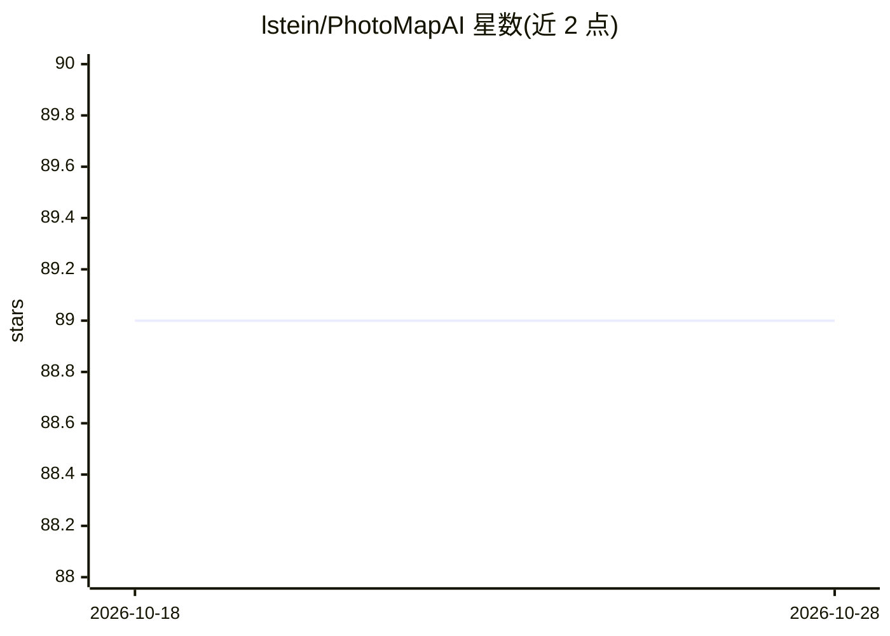

# lstein/PhotoMapAI

⭐ 89 · Python · MIT · 推送 2026-10-26 · [GitHub](https://github.com/lstein/PhotoMapAI) · [官网](https://lstein.github.io/PhotoMapAI/) · 个人维护 · 中文 README

**用 CLIP 生成照片集"语义地图"的本地图片浏览与搜索工具**

面向大型本地照片库的网页版图片浏览器与搜索工具：用 CLIP 模型对图片做嵌入，支持文本、图片及组合的相似度搜索、按内容主题聚类并可视化成语义地图；所有图片保留在本地不上传。附带相册管理、书签、元数据（含 GPS）查看、视频以截帧索引、为 LoRA 训练挑选图片的 Curator 模式，以及 InvokeAI 生成元数据读取。提供 macOS/Windows/Linux 安装包、PyPI、Docker 与源码安装；首次启动自动下载 Python 与 AI 库，自动检测 NVIDIA GPU 与 Apple Silicon 加速。

## 筛选速览

| 维度 | 判定 | 备注 |
|---|---|---|
| AI 角色 | `ai-enhanced` | 去掉 AI 部分产品仍成立 |
| 许可风险 | `permissive` | MIT |
| 部署形态 | `desktop` | 安装包/桌面程序 |
| 模型依赖 | — | README 未给出锁定关系 |
| 硬件要求 | — | 无带数字的原话,不猜 |
| 安装摩擦 | `medium` | 含编译或系统依赖之一 |
| 成熟度 | — | 结构信号不足 |

## 能力要点

- CLIP 驱动的文本/图片/组合相似度搜索
- 按内容主题聚类并可视化交互式"语义地图"
- 全本地运行，图片不上传互联网
- Curator 模式为 LoRA/分类器训练挑选均衡图片集

## 适用场景

- 在大型本地照片库中按人物、地点、事件、风格搜索照片
- 浏览语义地图发现主题相关的照片分组
- 为 LoRA 训练或分类器挑选合适的图片子集

## 场景标签

`语义搜索` · 领域:知识与检索

## 证据(README 行号)

> L7: PhotoMapAI is a fast, modern image browser and search tool for large photo collections. It uses the CLIP computer vi
> L17: - Curator mode for selecting a balanced set of images to use for LoRA training
> L58: If you are a user of the InvokeAI text-to-image generation tool, you can get quick access to the key settings used 

## 星数曲线

2026-10-18 89 → 2026-10-28 89（+0）

---
*卡片 v1 · prompt 1.4 · 生成 2026-10-23 · 置信度 mid · 依据 README sha `1b9778978d6a` · [字段定义](../../DATASET.md)*
