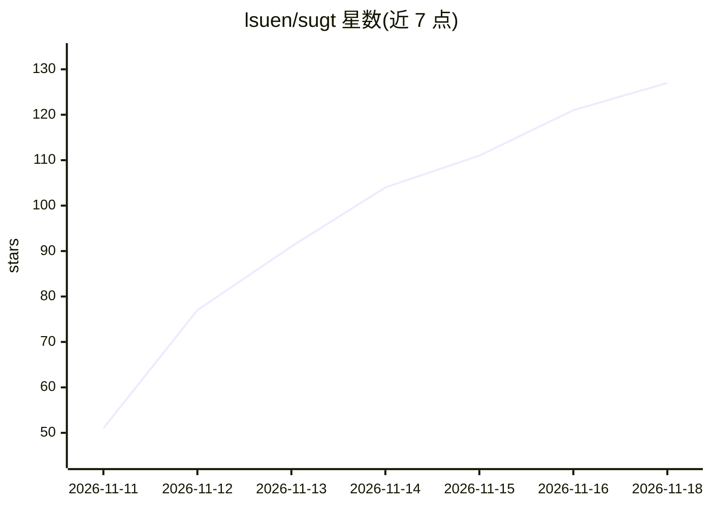

# lsuen/sugt

⭐ 127 · Rust · Apache-2.0 · 推送 2026-11-13 · [GitHub](https://github.com/lsuen/sugt) · [官网](https://github.com/lsuen/sugt) · 个人维护 · 中文 README

**本地 AI 网关与技能控制台：统一管理多 LLM 密钥供编码客户端接入**

面向桌面用户的本地 AI 网关：将 OpenAI、Anthropic、ModelScope、火山引擎、硅基流动、Kimi、DeepSeek 等多家供应商的 API 密钥集中到单一 OpenAI/Anthropic 兼容代理后，Claude Code、Codex、OpenCode 等编码客户端统一接入本地端点，并支持多上游故障转移、协议双向转换与热重载配置。附 Skills 控制台用于发现、安装、挂载技能，SOUL 伴聊助手，以及一键接管 22 种已知客户端。Windows 提供 winget/安装包，macOS 提供 Homebrew cask，Apache-2.0 开源。

## 筛选速览

| 维度 | 判定 | 备注 |
|---|---|---|
| AI 角色 | `ai-ecosystem` | LLM/agent 周边工具 |
| 许可风险 | `permissive` | Apache-2.0 |
| 部署形态 | `desktop` | 安装包/桌面程序 |
| 模型依赖 | — | README 未给出锁定关系 |
| 硬件要求 | — | 无带数字的原话,不猜 |
| 安装摩擦 | `medium` | 含编译或系统依赖之一 |
| 成熟度 | — | 结构信号不足 |

## 能力要点

- 单一 OpenAI/Anthropic 兼容代理聚合多家 LLM 供应商密钥
- Anthropic 与 OpenAI 协议双向转换（含 SSE 流式）与多上游故障转移
- 一键接管 22 种已知 AI 编码客户端的 Base URL 与鉴权
- Skills 控制台：从 GitHub/Gitee 等源安装技能并可跨多 agent 挂载

## 适用场景

- 把散落各处的 LLM API 密钥统一到一个本地网关管理
- 让 Claude Code、Codex 等多个编码客户端共用同一本地端点并随时切换上游模型
- 集中发现、安装与挂载 AI 技能库

## 场景标签

`模型网关` · 领域:Agent 开发

## 证据(README 行号)

> L3: **SUGT (su gateway)** is a local AI gateway and skills control plane for your desktop. It centralizes API keys from 
> L35: - Axum HTTP server embedded in the Tauri process, speaking **OpenAI Chat Completions**, **Anthropic Messages**, and

## 星数曲线

2026-11-11 51 → 2026-11-18 127（+76）

---
*卡片 v1 · prompt 1.4 · 生成 2026-11-17 · 置信度 mid · 依据 README sha `b8f4fc343940` · [字段定义](../../DATASET.md)*
