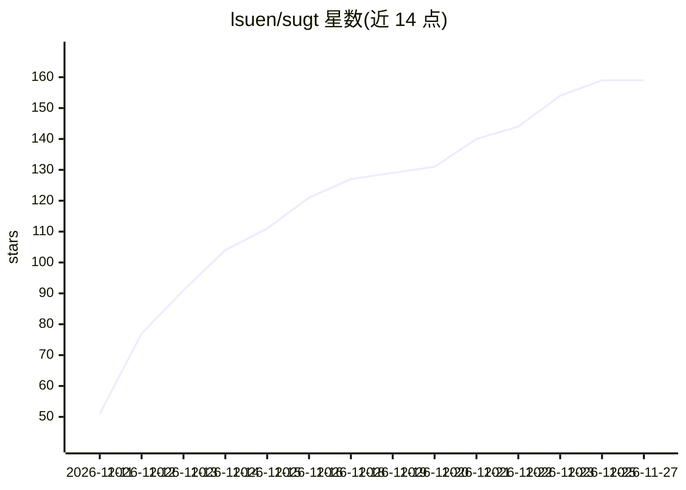

# lsuen/sugt

⭐ 159 · Rust · Apache-2.0 · 推送 2026-11-25 · [GitHub](https://github.com/lsuen/sugt) · [官网](https://github.com/lsuen/sugt) · 个人维护 · 中文 README

**给多 Agent 开发者的本机 AI 网关与技能中控台**

跑在本机的 AI 工作台，以 Tauri 桌面应用 + 独立 CLI 形式提供。核心是在进程内启动 Axum HTTP 网关，支持 OpenAI Chat/Anthropic Messages/Responses 三种协议并双向互转，把多个上游模型的 Key 与 Base URL 收拢为单一本机端点，提供多上游故障切换、配置热加载与上游 Key 轮换。客户端接管模块覆盖 22 个编码 Agent 客户端，可写入环境变量或配置文件指向本机网关。另含技能安装/挂载中控、全局规则注入与请求改写、局域网 WebUI 管理面。默认绑定回环，非回环绑定时强制校验客户端 API Key。

## 筛选速览

| 维度 | 判定 | 备注 |
|---|---|---|
| AI 角色 | `ai-ecosystem` | LLM/agent 周边工具 |
| 许可风险 | `permissive` | Apache-2.0 |
| 部署形态 | `desktop` | 安装包/桌面程序 |
| 模型依赖 | locked-api |  |
| 硬件要求 | — | 无带数字的原话,不猜 |
| 安装摩擦 | `medium` | 含编译或系统依赖之一 |
| 成熟度 | — | 结构信号不足 |

## 能力要点

- 单本机端点聚合多上游，支持 OpenAI/Anthropic/Responses 协议互转与故障切换
- 22 个编码 Agent 客户端的一键接管与解除（含环境变量与配置文件写入）
- 技能从 Git 仓库安装、按 SKILL.md 触发词挂载，卸载不删库
- 局域网 WebUI 与 CLI（sugt-cli serve/status/test/env/init/webui）管理面

## 适用场景

- 同时使用 Claude Code、Codex 等多个编码 Agent 时统一管理 Key 与上游
- 换模型或换上游时不改动各客户端配置
- 在局域网内用浏览器设备管理网关与技能
- 为团队内网服务器部署无头网关（Linux CLI + systemd）

## 场景标签

`模型网关` · 领域:Agent 开发

## 证据(README 行号)

> L5: **SUGT**（su gateway）不只是一个本地代理端口——它是跑在你电脑上的 **AI 工作台**：把「上游模型怎么接」「编码 Agent 怎么进」「技能怎么管」「规则怎么注入」收成一块本机控制面。OpenAI / Anth
> L58: - 在 Tauri 进程内启动 Axum HTTP 服务器，同时支持 **OpenAI Chat Completions**、**Anthropic Messages**、**OpenAI Responses** 三种协议
> L77: - 入口在 **接入 → 客户端**。单一目录收录 22 个国内外常见客户端（Claude Code、Codex、CodeBuddy、Trae、通义灵码、iFlow、Kimi CLI、Qoder、Comate、CodeGeeX、W

## 星数曲线

2026-11-11 51 → 2026-11-27 159（+108）

---
*卡片 v1 · prompt 1.4 · 生成 2026-11-27 · 置信度 mid · 依据 README sha `46a2950a9d26` · [字段定义](../../DATASET.md)*
