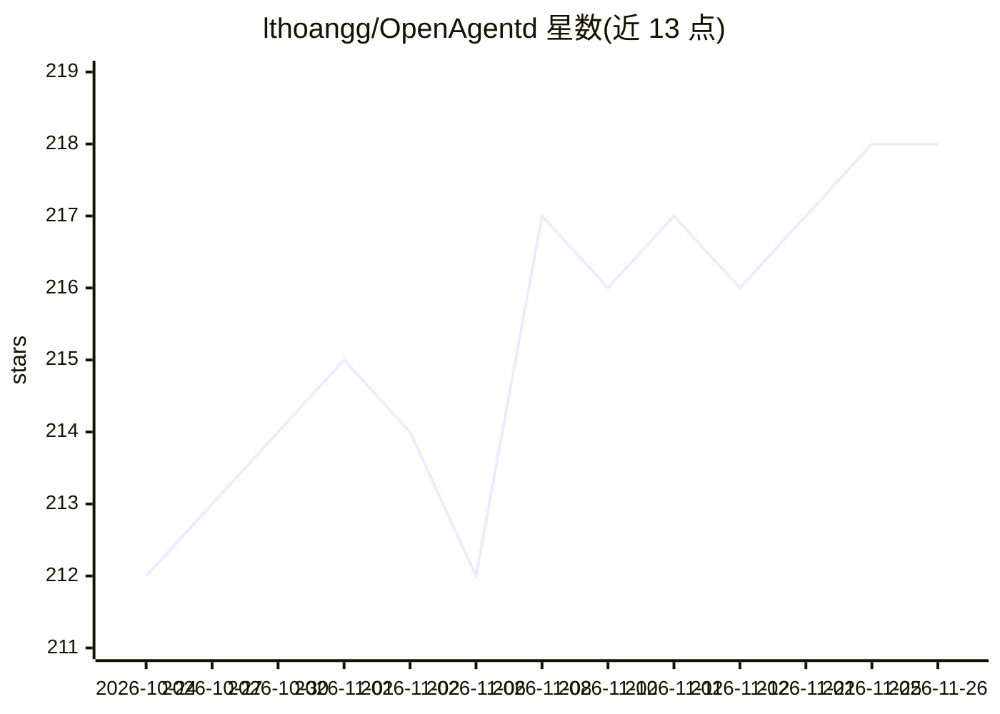

# lthoangg/OpenAgentd

⭐ 218 · TypeScript · Apache-2.0 · 推送 2026-11-25 · [GitHub](https://github.com/lthoangg/OpenAgentd) · [官网](https://openagentd.dev) · 个人维护

**本地运行的编程 agent 桌面应用：可视审阅每步工具调用与改动**

在自己电脑上运行编程 agent 的桌面应用：给定文件夹与任务后，agent 规划、读取、编辑文件、运行测试；应用把每次工具调用（含参数与耗时）、每处 diff、终端输出与成本流式展示为一份记录，可在中途干预，提交前审阅变更。提供 Plan/Code 两种模式、子 agent 委派、MCP 服务器与插件扩展，以及配套 iPhone/Android 应用远程查看与审批会话。后端为单个 Rust 二进制，会话与设置留在本机。

## 筛选速览

| 维度 | 判定 | 备注 |
|---|---|---|
| AI 角色 | `ai-native` | 本体是模型或模型工具 |
| 许可风险 | `permissive` | Apache-2.0 |
| 部署形态 | `desktop` | 安装包/桌面程序 |
| 模型依赖 | local-ok | 支持本地模型 |
| 硬件要求 | — | 无带数字的原话,不猜 |
| 安装摩擦 | `low` | 无编译、无系统依赖或容器化 |
| 成熟度 | `idea` | |

## 能力要点

- 工具调用、diff、终端输出与 token 成本聚合为单一可审记录
- Plan 模式只读探索并生成计划，经评论与批准后才执行修改
- 内置 18 个模型提供方接入，含本地 Ollama 与订阅账号登录
- 子 agent 委派与 MCP/插件/skills 扩展机制

## 适用场景

- 让 agent 在本地仓库执行编码任务并逐步审阅其改动
- 在改动写入前用 Plan 模式评论并批准方案
- 通过手机配对查看、回复或停止正在运行的 agent 会话

## 场景标签

`编码 Agent` · 领域:编码与开发

## 证据(README 行号)

> L15: **OpenAgentd is a desktop app for running a coding agent on your own machine.** You give it a folder and a task. It
> L23: - **Nothing happens off-screen.** Tool calls, reasoning, shell output, file edits, todos, tokens and cost stream in
> L24: - **You decide when code changes.** Plan mode explores read-only and writes a plan you can comment on, then approve

## 星数曲线

2026-10-24 212 → 2026-11-26 218（+6）

---
*卡片 v1 · prompt 1.4 · 生成 2026-11-25 · 置信度 high · 依据 README sha `a95d2e749995` · [字段定义](../../DATASET.md)*
