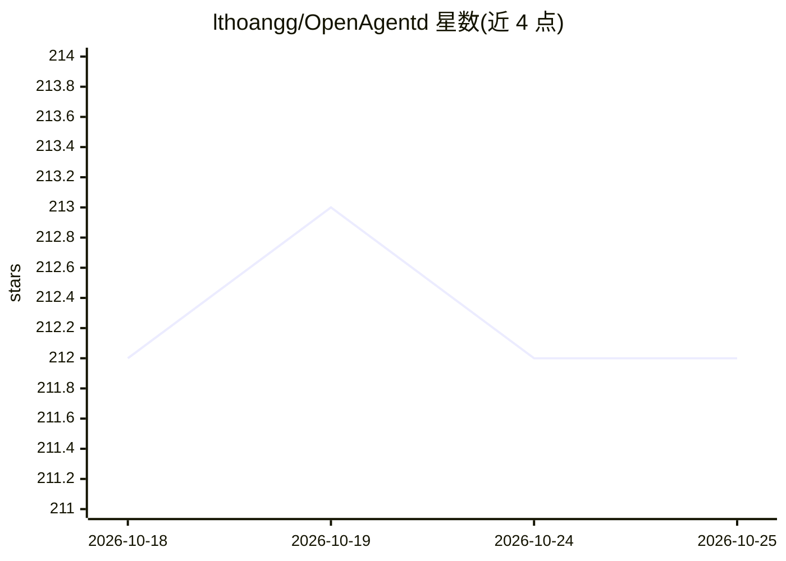

# lthoangg/OpenAgentd

⭐ 212 · TypeScript · Apache-2.0 · 推送 2026-10-25 · [GitHub](https://github.com/lthoangg/OpenAgentd) · [官网](https://openagentd.dev) · 个人维护

**本地优先的桌面端编码 agent：透明展示每步工具调用**

用 Rust 构建的桌面应用，在用户本机运行编码 agent：给定文件夹与任务后，agent 进行规划、读写文件、运行测试，并把每次工具调用、diff、终端输出与成本汇入同一转录流。支持 19+ 家模型提供商（Anthropic、OpenAI、Gemini、OpenRouter、Bedrock、DeepSeek 等）及通过 Ollama 接入本地模型；提供 Plan/Code 两种模式、子代理委派、Git 集成与 MCP。macOS/Linux/Windows 有安装脚本与 Homebrew，另有仅装后端的 CLI server 模式。会话数据保留在本机。

## 筛选速览

| 维度 | 判定 | 备注 |
|---|---|---|
| AI 角色 | `ai-native` | 本体是模型或模型工具 |
| 许可风险 | `permissive` | Apache-2.0 |
| 部署形态 | `desktop` | 安装包/桌面程序 |
| 模型依赖 | local-ok | 支持本地模型 |
| 硬件要求 | — | 无带数字的原话,不猜 |
| 安装摩擦 | `low` | 无编译、无系统依赖或容器化 |
| 成熟度 | — | 结构信号不足 |

## 能力要点

- 工具调用、diff、shell 输出、token 与成本汇入单一转录流
- 19+ 提供商接入，含现有 ChatGPT/Copilot/Grok 订阅与 Ollama 本地模型
- Plan 模式只读探索并产出可评论的计划，Code 模式可中途转向或停止
- 单一原生 Rust 后端（约 43 MB），支持子代理委派与 MCP

## 适用场景

- 在本机运行编码 agent 并逐条审查其工具调用与改动
- 提交前审查 agent 生成的代码 diff
- 用自己已有的模型 key 或本地 Ollama 模型驱动编码任务
- 通过手机 App 连接电脑上的会话

## 场景标签

`编码 Agent` · 领域:编码与开发

## 证据(README 行号)

> L15: **OpenAgentd is a desktop app for running a coding agent on your own machine.** You give it a folder and a task. It
> L26: - **Your models, your keys.** 19+ providers, including Anthropic, OpenAI, Gemini, OpenRouter, Bedrock and DeepSeek,

## 星数曲线

2026-10-18 212 → 2026-10-25 212（+0）

---
*卡片 v1 · prompt 1.4 · 生成 2026-10-22 · 置信度 high · 依据 README sha `9c0374def5f1` · [字段定义](../../DATASET.md)*
