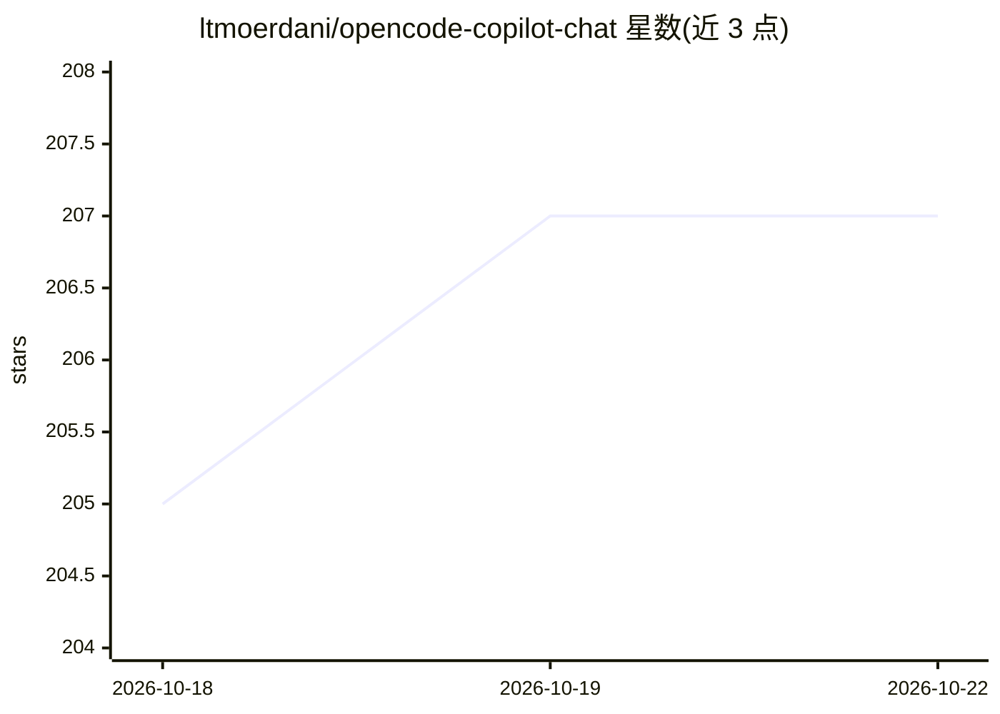

# ltmoerdani/opencode-copilot-chat

⭐ 208 · TypeScript · MIT · 推送 2026-10-20 · [GitHub](https://github.com/ltmoerdani/opencode-copilot-chat) · [官网](https://opencode.ai) · 个人维护

**在 GitHub Copilot Chat 中接入 30+ AI 模型的 VS Code 扩展**

一个 VS Code 扩展，将 OpenCode 的模型网关（Go 订阅 $10/月与 Zen 按量付费，均需自带 API key）接入 Copilot Chat 的模型选择器，使 DeepSeek、Kimi、GLM、Claude、GPT、Gemini、Grok 等 30+ 模型可在原生 Copilot 界面、工具调用与 Agent Mode 中使用。支持双 provider 同开即时切换、每模型推理力度控制、视觉代理（为纯文本模型配图）、用量跟踪与上下文档位选择。限制：自 2026-09-17 起 Zen 免费档模型对第三方客户端返回 403，扩展自动隐藏。模型元数据按活接口→6 小时缓存→内置目录三级回退。

## 筛选速览

| 维度 | 判定 | 备注 |
|---|---|---|
| AI 角色 | `ai-ecosystem` | LLM/agent 周边工具 |
| 许可风险 | `permissive` | MIT |
| 部署形态 | `library` | 以包/库形式分发 |
| 模型依赖 | — | README 未给出锁定关系 |
| 硬件要求 | — | 无带数字的原话,不猜 |
| 安装摩擦 | `low` | 无编译、无系统依赖或容器化 |
| 成熟度 | — | 结构信号不足 |

## 能力要点

- 将 OpenCode Go/Zen 双 provider 的 30+ 模型接入 Copilot Chat 模型选择器
- 原生支持 Copilot Agent Mode 工具调用与 Agents 窗口
- 视觉代理：为纯文本模型经配置的视觉模型传图，描述按图缓存
- Go 订阅用量烧录率状态栏跟踪（5 小时/周/月三档）

## 适用场景

- 不购买 Copilot Pro，用自有 key 在 Copilot Chat 里使用更多模型
- 在原生 Copilot Agent Mode 中调用 DeepSeek/Kimi/GLM 等开放模型
- 同时挂载订阅与按量付费两组模型按需切换

## 场景标签

`模型网关` · 领域:Agent 开发

## 证据(README 行号)

> L20: > This extension plugs **OpenCode's model gateway** into Copilot Chat's model picker. **OpenCode Zen** gives you ro
> L51: 1. **Install or update VS Code** to version 1.125 or newer. OpenCode BYOK chat works without a GitHub sign-in or Co

## 星数曲线

2026-10-18 205 → 2026-10-22 207（+2）

---
*卡片 v1 · prompt 1.4 · 生成 2026-10-22 · 置信度 mid · 依据 README sha `004261a56161` · [字段定义](../../DATASET.md)*
