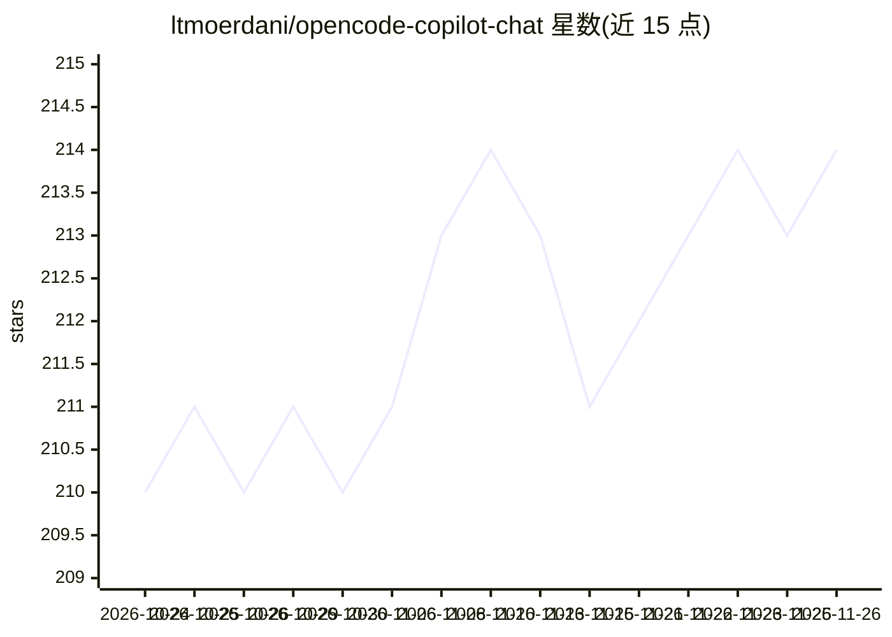

# ltmoerdani/opencode-copilot-chat

⭐ 214 · TypeScript · MIT · 推送 2026-11-25 · [GitHub](https://github.com/ltmoerdani/opencode-copilot-chat) · [官网](https://opencode.ai) · 个人维护

**把 OpenCode 网关模型接入 GitHub Copilot Chat 的 VS Code 扩展**

一款 VS Code 扩展，将 OpenCode 的模型网关接入 Copilot Chat 的模型选择器，使用户通过 BYOK 方式在原生 Copilot UI、工具调用与 Agent Mode 中调用 OpenCode Go（$10/mo 订阅制开放模型）与 OpenCode Zen（按量付费）的 30+ 模型。启动时从 /models 端点拉取实时模型列表，按三级回退解析模型元数据；支持每模型思考控制、视觉代理（文本模型借配置的视觉模型读图）、用量跟踪与按模型族的本地传输路由。限制：2026-09-17 起 Zen 免费档模型对第三方客户端返回 HTTP 403，扩展自动隐藏。

## 筛选速览

| 维度 | 判定 | 备注 |
|---|---|---|
| AI 角色 | `ai-ecosystem` | LLM/agent 周边工具 |
| 许可风险 | `permissive` | MIT |
| 部署形态 | `library` | 以包/库形式分发 |
| 模型依赖 | — | README 未给出锁定关系 |
| 硬件要求 | — | 无带数字的原话,不猜 |
| 安装摩擦 | `low` | 无编译、无系统依赖或容器化 |
| 成熟度 | — | 结构信号不足 |

## 能力要点

- 将 OpenCode Go/Zen 双通道模型接入 Copilot Chat 模型选择器，保留原生 Agent Mode 与工具调用
- 启动时实时拉取模型列表，三级回退（live / models.dev 快照 / 内置目录，支持离线）
- 视觉代理让纯文本模型读取图片，描述按图缓存复用
- 状态栏显示 Go 订阅在 5h/周/月三档的消耗速率

## 适用场景

- 在 Copilot Chat 中以 BYOK 使用 Claude、GPT、Gemini、DeepSeek 等多家族模型
- 用 $10/mo 的 Go 订阅获得带用量额度的开放模型集合
- 让不支持图像的模型通过视觉代理读图

## 场景标签

`模型网关` · 领域:Agent 开发

## 证据(README 行号)

> L20: > This extension plugs **OpenCode's model gateway** into Copilot Chat's model picker. **OpenCode Zen** gives you ro
> L28: |🤖 **Full Agent Mode**|Tool-calling (read files, edit, run terminal) works natively, not just chat. Models also app
> L34: |🎯 **Smart routing**|Each model family auto-routes to its native transport (`/responses`, `/messages`, `streamGener

## 星数曲线

2026-10-24 210 → 2026-11-26 214（+4）

---
*卡片 v1 · prompt 1.4 · 生成 2026-11-25 · 置信度 high · 依据 README sha `ca11b38f1e7e` · [字段定义](../../DATASET.md)*
