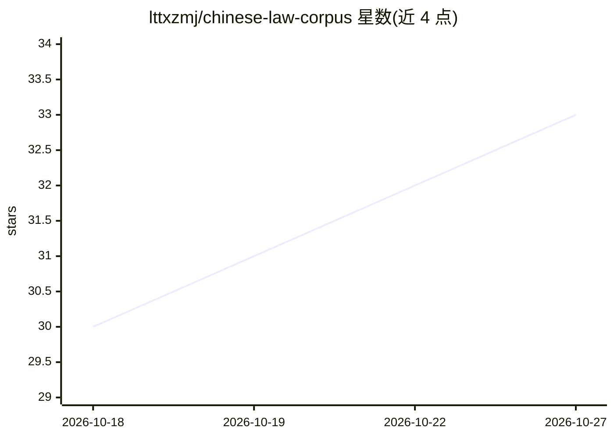

# lttxzmj/chinese-law-corpus

⭐ 33 · NOASSERTION · 推送 2026-10-21 · [GitHub](https://github.com/lttxzmj/chinese-law-corpus) · 个人维护 · 中文 README

**中国法律法规与案例的结构化 JSON 语料库（1513 部+723 案例）**

面向法律 AI 开发者与研究的结构化语料库：1513 部法律/司法解释/行政法规共 56,182 条逐条 JSON（编章节条层级，含效力状态、公布/施行日期、制定机关），另收 278 件最高法指导性案例与 445 件公报案例文书。数据取自国家法律法规数据库与最高法官方站点，条文带稳定 ID（如 civil-code-0577），一条一法条可直接作 RAG chunk。经 jsDelivr CDN 提供免鉴权 JSON API，配套 MCP 服务器可将语料接入 AI 客户端。数据以 CC0 释出，由法脉数据管道脚本自动同步官方更新。

## 筛选速览

| 维度 | 判定 | 备注 |
|---|---|---|
| AI 角色 | `ai-knowledge` | 知识聚合/清单类 |
| 许可风险 | `none` | NOASSERTION |
| 部署形态 | `library` | 以包/库形式分发 |
| 模型依赖 | — | README 未给出锁定关系 |
| 硬件要求 | — | 无带数字的原话,不猜 |
| 安装摩擦 | `low` | 无编译、无系统依赖或容器化 |
| 成熟度 | — | 结构信号不足 |

## 能力要点

- 1513 部法规逐条结构化，含效力状态与稳定条文 ID
- 278 件指导性案例（关键词/裁判要点/理由分字段）+445 件公报案例
- jsDelivr CDN 免费 JSON API，支持 HTTPS 与 CORS
- 配套 chinese-law-mcp 可接入任意支持 MCP 的 AI 客户端

## 适用场景

- 为法律 RAG 系统提供一条一法条粒度的检索语料
- 构建法律检索基准或引用锚定的生成评测集
- 通过 MCP 让 AI 助手查询中国法条与案例

## 场景标签

 · 领域:法律/数据集

## 证据(README 行号)

> L40: Structured corpus of Chinese law in clean JSON, released under CC0: **1513 statutes,
> L48: ```python
> L49: # RAG 检索粒度示例：一条 = 一个法条，天然的 chunk 边界

## 星数曲线



2026-10-18 30 → 2026-10-27 33（+3）


---
*卡片 v1 · prompt 1.4 · 生成 2026-10-26 · 置信度 mid · 依据 README sha `83aee6720f42` · [字段定义](../../DATASET.md)*
