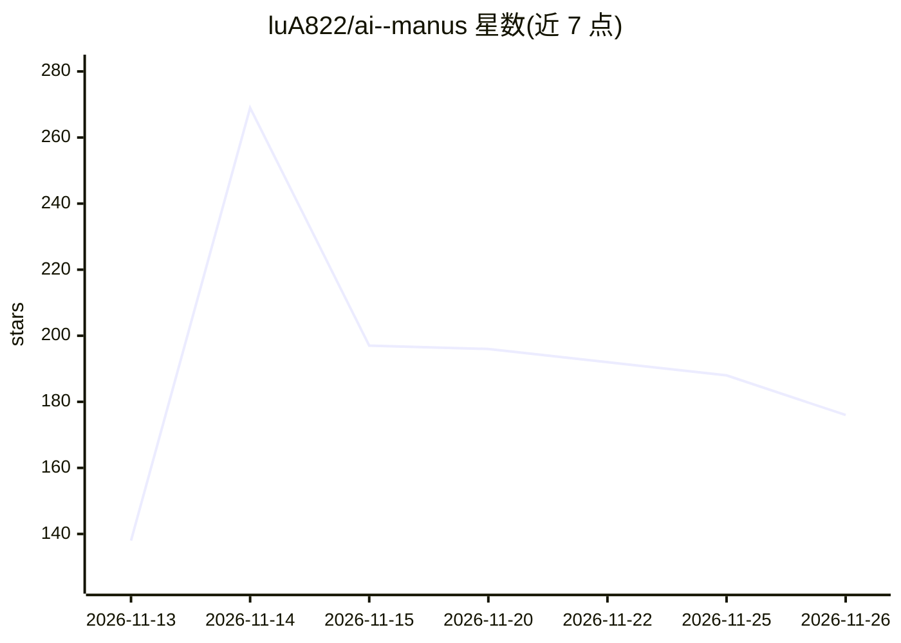

# luA822/ai--manus

⭐ 176 · Apache-2.0 · 推送 2026-11-15 · [GitHub](https://github.com/luA822/ai--manus) · 个人维护

**面向个人用户的自主 AI Agent：代跑代码、控制浏览器完成日常任务**

README 宣称 Manus 是一个自主 AI Agent，可代替用户编写并执行脚本、控制浏览器（导航网页、填表、采集信息）并执行多步任务，面向家庭、学习与轻量办公场景而非企业平台。文中描述其可跨会话复用任务模式，代码与浏览器操作可在同一流程衔接。README 未给出具体的模型接入方式、安装命令或代码内容，主要是功能介绍与使用建议，并附系统兼容性表（最低 4GB 内存、双核 CPU）。

## 筛选速览

| 维度 | 判定 | 备注 |
|---|---|---|
| AI 角色 | `ai-native` | 本体是模型或模型工具 |
| 许可风险 | `permissive` | Apache-2.0 |
| 部署形态 | `None` |  |
| 模型依赖 | — | README 未给出锁定关系 |
| 硬件要求 | — | 无带数字的原话,不猜 |
| 安装摩擦 | `low` | 无编译、无系统依赖或容器化 |
| 成熟度 | — | 结构信号不足 |

## 能力要点

- 自主执行代码与控制浏览器（导航/填表/采集信息）
- 支持多步任务与跨会话的任务模式复用
- 代码与浏览器操作可在同一流程内衔接
- README 提供系统兼容性表（最低 4GB RAM/双核 CPU）

## 适用场景

- 让 Agent 代为执行重复性的网页操作与数据收集
- 学习研究中自动整理资料、运行小脚本
- 轻量办公中跨多个页面汇总信息

## 场景标签

`编码 Agent` `浏览器自动化` `AI 助手` · 领域:效率与自动化

## 证据(README 行号)

> L10: - **Autonomous Code Execution:** Manus AI agent runs code on its own to complete tasks, so you can focus on decisio
> L18: Manus is an autonomous AI agent designed to run code and control a browser on your behalf. Instead of acting like a

## 星数曲线

2026-11-13 138 → 2026-11-26 176（+38）

---
*卡片 v1 · prompt 1.4 · 生成 2026-11-17 · 置信度 low · 依据 README sha `fbfd5e977bf4` · [字段定义](../../DATASET.md)*
