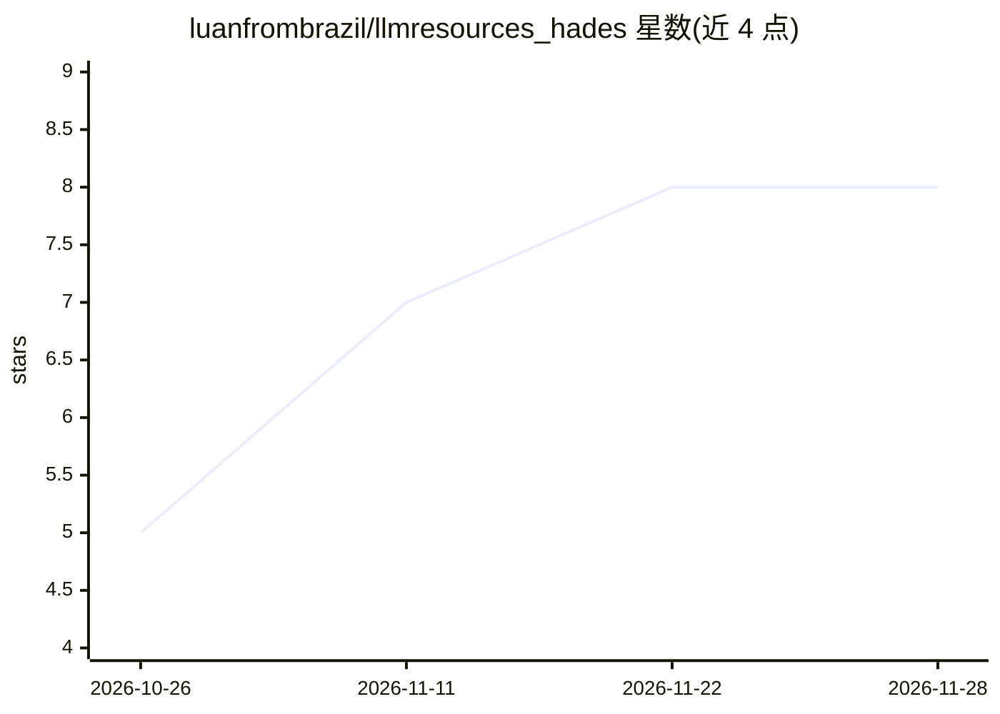

# luanfrombrazil/llmresources_hades

⭐ 8 · Python · 推送 2026-10-23 · [GitHub](https://github.com/luanfrombrazil/llmresources_hades) · 个人维护

**给 LLM 生成 HADES 电路仿真文件的文档参考库**

为 HADES 仿真框架（hades.jar）的 .hds 电路文件提供参考文档：.hds 语法、45 个组件的参数与端口坐标、布局与连线规则、子电路层级、ROM/RAM 内容格式，以及用 Python 批量生成大型项目的工具（tools/gerador/，含自动校验）。文档按推荐阅读顺序组织，并附带完整示例文件。作者面向使用 HADES 的学生与教师，供 LLM 读取上下文后自主创建电路文件，另含学术诚信与使用责任说明。

## 筛选速览

| 维度 | 判定 | 备注 |
|---|---|---|
| AI 角色 | `ai-knowledge` | 知识聚合/清单类 |
| 许可风险 | `none` | — |
| 部署形态 | `None` |  |
| 模型依赖 | — | README 未给出锁定关系 |
| 硬件要求 | — | 无带数字的原话,不猜 |
| 安装摩擦 | `low` | 无编译、无系统依赖或容器化 |
| 成熟度 | — | 结构信号不足 |

## 能力要点

- 45 个 HADES 组件的参数、端口与位置文档（components/）
- .hds 文件语法与布局/连线/复位规则
- Python 批量生成器（GERADOR.md，带自动校验）
- 完整可加载的示例电路文件（examples/）

## 适用场景

- 让 LLM 依据文档自主生成可加载的 .hds 电路文件
- 课程中用 LLM 解释、修改或批量生成处理器数据通路电路
- 教师批量生成练习变体、参考答案与课堂演示电路

## 场景标签

 · 领域:EDA/电路仿真与教学

## 证据(README 行号)

> L1: # Biblioteca HADES para LLMs
> L3: Referência para gerar arquivos `.hds` (esquemáticos do simulador HADES, `hades.jar`). Portas, posições, bbox e forma
> L7: 1. `FORMATO_HDS.md`: gramática do `.hds` (obrigatório).

## 星数曲线

2026-10-26 5 → 2026-11-28 8（+3）

---
*卡片 v1 · prompt 1.4 · 生成 2026-11-21 · 置信度 high · 依据 README sha `025d123503eb` · [字段定义](../../DATASET.md)*
